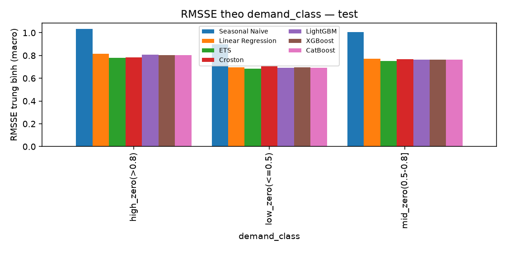
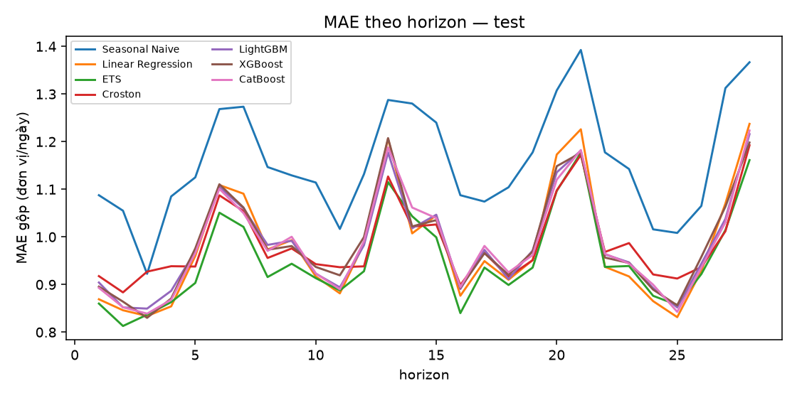
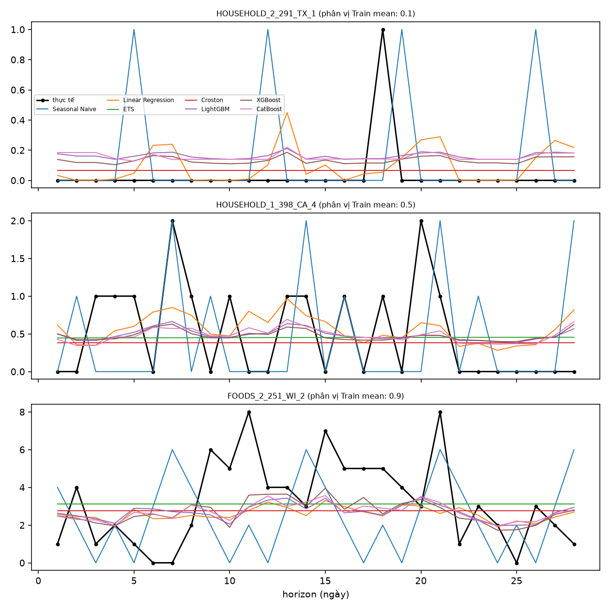
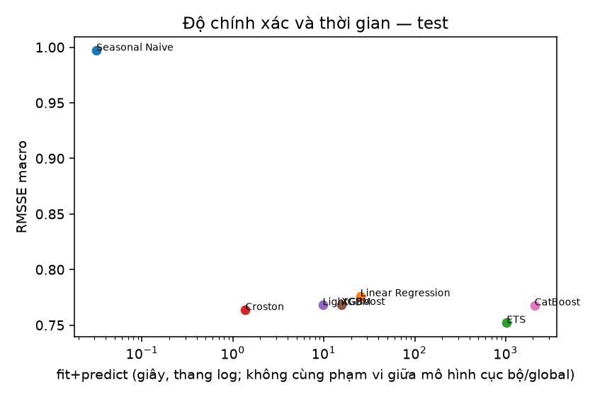
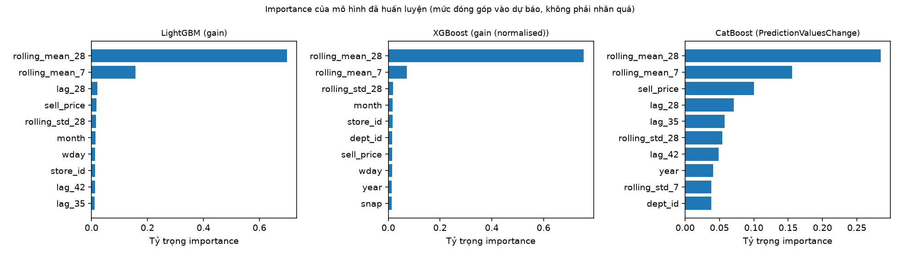
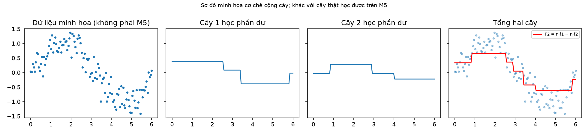

# So sánh các phương pháp dự báo nhu cầu bán lẻ trên dữ liệu M5

**Môn:** Phân tích dữ liệu kinh doanh — IS403.R11. **Nhóm:** 6 (Tuấn Hải, Tuấn Vũ, Thanh Tiền, Thủy Tiên, Thùy Trang). Họ tên đầy đủ và MSSV chờ đối chiếu danh sách chính thức.

> **Tình trạng bản thảo.** Bản thảo nội dung (chưa định dạng, không dùng template), do AI soạn từ kết quả thực nghiệm thật; chưa có thành viên nào review hay đối chiếu. Mọi con số trong mục 4 truy được về `run_id` và bảng trong `results/` (các bảng được sinh tự động bằng `scripts/build_report.py`). Nhóm cần tự: đối chiếu họ tên/MSSV, đọc lại toàn văn các nguồn đánh dấu "chưa đọc lại toàn văn", định dạng và nộp bài.

## Tóm tắt

Dự báo số lượng bán hỗ trợ doanh nghiệp bán lẻ lập kế hoạch bổ sung hàng, nhưng nhu cầu ở cấp sản phẩm–cửa hàng thường gián đoạn và khó dự báo. Đồ án so sánh bảy phương pháp — Seasonal Naive, Linear Regression, ETS, Croston, LightGBM, XGBoost, CatBoost — cho dự báo điểm 28 ngày trên mẫu phân tầng 1.200 chuỗi Walmart M5 (seed 42, 10 cửa hàng × 3 ngành hàng). Dữ liệu được chia theo thời gian (Train d_1–1885, Validation d_1886–1913, Test d_1914–1941); đặc trưng trễ lùi ít nhất 28 ngày và được kiểm thử không rò rỉ nhãn; cấu hình được khóa bằng tag `config-freeze` trước khi mở nhãn Test và Test chỉ chạy một lần. Hiệu quả đo bằng MAE, RMSE, RMSSE, R² và thời gian chạy. Trên Test, mọi mô hình học/thống kê giảm khoảng 22–25% macro-RMSSE so với Seasonal Naive (0,997); ETS đạt thấp nhất (0,752), tiếp theo Croston (0,764), LightGBM và XGBoost (0,768), Linear Regression (0,776). CatBoost (0,768) ngang LightGBM và XGBoost. ETS và Croston vượt các mô hình global ở nhóm chuỗi gián đoạn mạnh, còn ở nhóm ít số 0 các mô hình gần nhau; ETS tốn khoảng 100 lần thời gian CPU của LightGBM, Croston gần như không tốn. Giới hạn: một cửa sổ Test 28 ngày, mẫu 1.200 chuỗi, giả định giá tương lai, khác biệt input giữa mô hình cục bộ và global, chưa đo chi phí tồn kho; Optuna, stacking, Croston SBA và ablation không được chạy.

**Từ khóa:** dự báo bán lẻ, M5, nhu cầu gián đoạn, gradient boosting, ETS, Croston, đánh giá chuỗi thời gian.

## 1. Introduction

Trong bán lẻ, quyết định bổ sung hàng cần dựa trên nhu cầu tương lai. Dự báo thấp làm tăng nguy cơ thiếu hàng; dự báo cao làm tăng tồn kho. Việc chọn phương pháp dự báo vì vậy phải cân nhắc đồng thời sai số, thời gian tính toán và khả năng giải thích.

Đồ án khảo sát bài toán dự báo số lượng bán theo ngày của từng sản phẩm tại từng cửa hàng trên dữ liệu M5 của Walmart. **Đầu vào** là lịch sử doanh số của chuỗi (sản phẩm–cửa hàng) đến ngày gốc (origin) $T$, cùng các biến bổ trợ: lịch, sự kiện, SNAP theo bang và giá bán theo tuần. **Đầu ra** là vector 28 dự báo điểm không âm $\hat y_{i,T+1},\dots,\hat y_{i,T+28}$ cho mỗi chuỗi $i$.

Bài toán có ba thách thức. (i) *Nhu cầu gián đoạn*: trong mẫu của nhóm 70,1% số ngày bán bằng 0 (toàn bộ 30.490 chuỗi: 68,4%), khiến các độ đo tỷ lệ phần trăm không dùng được và nhiều giả định của mô hình thống kê khó thỏa. (ii) *Mùa vụ tuần và khác biệt nhóm hàng*: chỉ số doanh số cuối tuần (thứ Bảy, Chủ nhật) cao hơn khoảng 20% so với trung bình tuần, còn các ngày giữa tuần thấp hơn khoảng 12% (Bảng D07, `results/tables/d07_eda_weekday.csv`). (iii) *Rò rỉ thông tin*: đặc trưng trễ và thống kê trượt phải được dựng đúng theo thời điểm thông tin sẵn có với horizon 28 ngày.

Nhóm đặt bốn câu hỏi: (Q1) các mô hình thống kê và boosting cải thiện bao nhiêu so với Seasonal Naive; (Q2) hiệu quả khác nhau thế nào giữa nhóm nhu cầu (từ tỷ lệ ngày 0 trên Train), ngành hàng và bang; (Q3) mức cải thiện độ chính xác đi cùng chi phí tính toán nào; (Q4) cơ chế mỗi phương pháp giải thích được hành vi dự báo nào. Đóng góp là một pipeline dùng chung, một phép so sánh trên cùng mẫu, cùng horizon và cùng độ đo, với truy vết từ bảng/hình về dữ liệu dự báo. Đây là tái lập có giới hạn bối cảnh M5 và so sánh thuật toán trong điều kiện tài nguyên của nhóm; không phải tái lập hệ thống đội thắng cuộc thi.

## 2. Related Work

**Bối cảnh M5.** Makridakis, Spiliotis và Assimakopoulos (2022) tổng kết cuộc thi M5 Accuracy: dự báo 28 ngày doanh số của Walmart cho 42.840 chuỗi ở 12 cấp phân cấp (30.490 chuỗi sản phẩm–cửa hàng là cấp đáy), xếp hạng bằng WRMSSE. Theo bản tóm tắt của nhóm (`paper/summary.md`), đội thắng dùng LightGBM, WRMSSE 0,520, cải thiện 22,4% so với đối chuẩn thống kê tốt nhất; đáng chú ý chỉ 7,5% đội vượt đối chuẩn đó, nên dùng học máy không tự bảo đảm tốt hơn. Đồ án dùng RMSSE/MAE/RMSE/R² trên mẫu 1.200 chuỗi đáy, **không đồng nhất** với WRMSSE và không so thứ hạng với bảng xếp hạng M5 [1].

**Phương pháp thống kê và nhu cầu gián đoạn.** ETS (làm mượt mũ có xu hướng/mùa) được lựa chọn tự động theo tiêu chí thông tin AIC hiệu chỉnh (AICc) trong khung của Hyndman và Khandakar (2008) [2]. Với chuỗi nhiều ngày 0, Croston (1972) tách ước lượng làm mượt của lượng bán khác 0 và của khoảng cách giữa các lần phát sinh nhu cầu [3]; Syntetos và Boylan (2005) chỉ ra ước lượng Croston có thiên lệch và đề xuất hiệu chỉnh (SBA) [4]. Nhóm dùng Croston cổ điển; SBA nằm ngoài phạm vi lõi.

**Hồi quy và boosting.** Gradient boosting cộng dần các cây quyết định để giảm hàm mất mát (Friedman, 2001) [5]. LightGBM (Ke và cs., 2017) giảm chi phí huấn luyện bằng lấy mẫu theo gradient (GOSS) và gộp đặc trưng loại trừ (EFB) [6]; XGBoost (Chen và Guestrin, 2016) nhấn mạnh hệ thống boosting mở rộng được với chính quy hóa tường minh [7]; CatBoost (Prokhorenkova và cs., 2018) xử lý biến phân loại bằng thống kê mục tiêu có thứ tự và boosting có thứ tự để giảm *target leakage* [8]. Bandara và cs. (2022) dùng ensemble các mô hình global (trong đó có LightGBM) cho M5, nhấn mạnh học chéo giữa các chuỗi thay vì fit từng chuỗi [9].

**Tổng hợp và khoảng trống.** Các công trình trên khác nhau về dữ liệu, horizon, chiến lược local/global, biến ngoại sinh và độ đo, nên thứ hạng không chuyển trực tiếp sang thiết lập của nhóm. Đóng góp của đồ án nằm ở việc đặt bảy mô hình dưới cùng mẫu, cùng cắt thời gian và cùng độ đo, đồng thời công bố khác biệt input (univariate so với exogenous) và local/global giữa chúng. Nguồn [1], [6], [9] được đối chiếu qua bản tóm tắt và hồ sơ tác giả trong repo (`paper/`); các nguồn [2]–[5], [7], [8] là bài gốc kinh điển, thông tin thư mục được ghi theo hiểu biết của nhóm và **chưa được đọc lại toàn văn trong phiên này**.

## 3. Phương pháp thực hiện

### 3.1. Dữ liệu, mẫu và chia thời gian

Dữ liệu gồm `calendar.csv`, `sell_prices.csv`, `sales_train_validation.csv`, `sales_train_evaluation.csv`, `sample_submission.csv`. Hai file doanh số có phần lịch sử trùng nhau (đã kiểm: d_1–d_1913 giống hệt nhau), nên pipeline dùng `sales_train_evaluation.csv` (d_1–d_1941) để chia tập, không nối chồng. `sample_submission.csv` chỉ là khuôn đầu ra, không chứa nhãn. Khóa chuỗi là `series_id` = `item_id_store_id` (bỏ hậu tố `_validation/_evaluation`); mọi phép nối theo khóa, không theo thứ tự dòng.

**Mẫu.** 1.200 chuỗi chọn phân tầng theo cửa hàng × ngành hàng (10 × 3 = 30 tầng, mỗi tầng 40 chuỗi), seed 42; hash manifest SHA-256 `68d7acc8ef39f266d5b8274569fc25869c4187ba160a07686a2b292b0d5940f4`. Mức đại diện chỉ dùng thống kê Train (Bảng 1). Mẫu không bị chọn lại sau khi thấy kết quả.

*Bảng 1. Đại diện của mẫu so với 30.490 chuỗi (Train d_1–d_1885; nguồn `results/tables/d02_*.csv`).*

| Chỉ tiêu | Toàn bộ | Mẫu |
|---|---|---|
| Số chuỗi | 30.490 | 1.200 |
| Tỷ lệ ngày bán 0 | 0,684 | 0,701 |
| Doanh số trung bình/ngày | 1,122 | 1,019 |
| Nhóm tỷ lệ 0 ≤ 0,5 | 21,4% | 19,4% |
| Nhóm 0,5–0,8 | 39,5% | 37,3% |
| Nhóm > 0,8 | 39,1% | 43,3% |

Mẫu hơi lệch về phía chuỗi gián đoạn mạnh hơn (43,3% so với 39,1% ở nhóm > 0,8), nên mức doanh số trung bình thấp hơn khoảng 9%. Ngưỡng nhóm 0,5/0,8 được cố định từ Train trước khi có Test.

| Tập | Ngày | Vai trò |
|---|---|---|
| Train | d_1–d_1885 | Huấn luyện, EDA, phân nhóm nhu cầu |
| Validation | d_1886–d_1913 | Chọn cấu hình |
| Test | d_1914–d_1941 | Đánh giá cuối, chỉ sau tag `config-freeze` |

Khi dự báo Test, mọi mô hình được fit lại trên d_1–d_1913 theo cùng recipe. `scripts/run_experiment.py --split test` từ chối chạy nếu chưa có tag `config-freeze`.

### 3.2. Đặc trưng và chống rò rỉ

Với chuỗi $i$ và ngày $t$, đặc trưng lõi là: $\text{lag}_k=y_{i,t-k}$, $k\in\{28,35,42\}$; $\text{rmean}_w=\frac1w\sum_{j=0}^{w-1}y_{i,t-28-j}$ và $\text{rstd}_w$ (độ lệch chuẩn mẫu) với $w\in\{7,28\}$ trên chuỗi đã lùi 28 ngày; `wday`, `month`, `year`; hai cặp sự kiện (tên, loại); SNAP của bang; `sell_price` và cờ `price_missing`; định danh `dept_id`, `cat_id`, `store_id`, `state_id`. Với origin $T$ và $t\le T+28$, mọi nguồn $y$ đều $\le T$; nhãn từ $T+1$ trở đi bị che bằng NaN trước khi dựng đặc trưng. Kiểm thử (`tests/test_no_leakage.py`) làm hỏng toàn bộ nhãn sau origin 1885 và 1913 rồi xác nhận đặc trưng và target không đổi, đồng thời kiểm ranh giới giữa các chuỗi. Đây là dự báo *trực tiếp* cả 28 ngày từ một origin, không đệ quy.

Giá thiếu (trước ngày sản phẩm được niêm yết) giữ NaN kèm `price_missing`, không back-fill; 21,3% ô chuỗi–ngày Train thiếu giá. **Giả định giá tương lai:** pipeline dùng giá tuần của chính ngày cần dự báo (bảng giá M5 công bố đến d_1969). Trong vận hành, điều này chỉ đúng nếu giá được lập kế hoạch trước; đây là giả định phải nêu, không phải bằng chứng nhân quả của giá. `item_id` không dùng làm biến phân loại (cardinality cao, đã có lag/rolling mang mức doanh số của chuỗi), khác danh sách trong `configs/features.yaml`.

Phép impute (trung vị), chuẩn hóa và mã hóa one-hot của Linear Regression được fit chỉ trên các dòng huấn luyện của fold tương ứng. Không dùng target encoding.

### 3.3. Seasonal Naive

Chu kỳ 7 ngày, lặp lại tuần cuối: $\hat y_{T+h}=y_{T-6+((h-1)\bmod 7)}$. Không có tham số học; làm mốc đối chiếu. Phản ứng kém khi tuần cuối bất thường (khuyết bán, sự kiện không lặp lại).

### 3.4. Linear Regression

$\hat y=\beta_0+\sum_j\beta_jx_j$, huấn luyện chung (global) trên toàn mẫu bằng bình phương tối thiểu thông thường. Biến số được impute trung vị và chuẩn hóa z-score; biến phân loại one-hot (bỏ nhóm đầu để tránh cộng tuyến với hệ số chặn). Hệ số của biến chuẩn hóa so sánh được độ lớn tương đối giữa các biến số, và là liên hệ điều kiện, không phải tác động nhân quả. Bảng hệ số thực học nằm ở `diag_linear_regression_coefficients.csv`.

### 3.5. ETS

AutoETS (statsforecast) chu kỳ 7, chọn cấu trúc (error, trend, season) trong họ ETS theo AICc; mỗi chuỗi fit riêng. Dự báo không bị cắt trong hàm mô hình; pipeline cắt tại 0 đồng loạt cho mọi mô hình (mục 3.9). Cấu trúc được chọn và $\alpha,\beta,\gamma$ của từng chuỗi được lưu ở `diag_ets.csv`; chuỗi lỗi được fallback sang Seasonal Naive và ghi lý do ở `diag_fallbacks.csv`.

### 3.6. Croston

Croston cổ điển (smoothing $\alpha=0{,}1$, mặc định của statsforecast): khi có nhu cầu $y_t>0$ cập nhật $z\leftarrow z+\alpha(y_t-z)$ và $p\leftarrow p+\alpha(q-p)$ với $q$ là khoảng cách tính theo ngày từ lần nhu cầu trước; dự báo phẳng $\hat y=z/p$. Cài đặt tham chiếu của nhóm (`croston_components`) được kiểm khớp dự báo statsforecast. Giá trị $z,p$ từng chuỗi ở `diag_croston.csv`.

### 3.7. LightGBM, XGBoost, CatBoost

Cả ba là mô hình global với cùng bảng đặc trưng; tham số là mặc định thư viện, chỉ đặt `random_state=42`, số luồng và cách khai báo biến phân loại: LightGBM nhận cột dạng `category`; XGBoost dùng `enable_categorical=True` (tree method mặc định); CatBoost khai báo `cat_features` (chuỗi). Mô hình boosting có dạng $F_m(x)=F_{m-1}(x)+\eta f_m(x)$, với cây $f_m$ học phần sai số còn lại; số cây, tốc độ học và độ sâu mặc định được ghi đầy đủ trong `model_parameters.json` của từng run. Không early stopping, không tuning (Optuna là phần tùy chọn, xem mục 3.10).

### 3.8. Local và global; khác biệt input

Seasonal Naive, ETS, Croston là *local* và chỉ thấy lịch sử doanh số của chính chuỗi. Linear Regression, LightGBM, XGBoost, CatBoost là *global* và thấy thêm giá, lịch, SNAP, nhóm hàng và đặc trưng trễ của mọi chuỗi. Vì vậy chênh lệch giữa hai nhóm gộp hiệu ứng của thuật toán và của thông tin ngoại sinh; bản ablation bỏ giá/sự kiện (X02) nằm ngoài phạm vi lõi. Pilot LightGBM theo chuỗi (C03) chỉ đo thời gian 10 chuỗi và không dùng để suy thời gian global.

### 3.9. Hậu xử lý

Mọi dự báo được cắt $\max(\hat y,0)$ (doanh số không âm), không làm tròn; số dự báo âm trước khi cắt của từng mô hình ghi ở `timings.json`. Chính sách giống nhau cho cả bảy mô hình.

### 3.10. Tối ưu và kết hợp dự báo

Bốn phần tùy chọn có mã nguồn và kiểm thử (PR #24). **Đã chạy trên Validation:** Optuna cho LightGBM (30 lượt, chỉ dùng nhãn Validation; Tuned đạt macro-RMSSE 0,7447 so với 0,7496 của Default, nên được chọn), Croston SBA (0,7425 so với 0,7447 của Croston cổ điển) và ablation LightGBM bỏ nhóm giá/sự kiện (0,7479). Chênh lệch giữa Tuned và Default được đo trên đúng cửa sổ dùng để chọn nên hơi lạc quan; Test mới là phép kiểm độc lập. Stacking Ridge (T02) khớp bộ gộp trên 67.200 dòng dự báo ngoài mẫu (hai mốc backtest 1829 và 1857 trong Train, nhãn tới d_1885; bốn mô hình cơ sở: Linear Regression, LightGBM Tuned, XGBoost, CatBoost), alpha = 1000 chọn bằng leave-one-origin-out và nằm đúng biên trên của lưới 0,1–1000. Trên Validation, stacking đạt macro-RMSSE 0,7519: **không tốt hơn** LightGBM Tuned (0,7447) hay ETS (0,7293), nhưng có RMSE gộp thấp nhất (2,0251 so với 2,0389 của CatBoost, mô hình tốt nhất kế tiếp). Trọng số: Linear Regression 0,378, LightGBM Tuned 0,323, XGBoost 0,195, CatBoost 0,173. Một giả thuyết (chưa kiểm) cho khoảng cách giữa hai thước đo là bộ gộp tối thiểu hóa sai số bình phương gộp nên ưu tiên chuỗi bán nhiều, trong khi macro-RMSSE chuẩn hóa theo từng chuỗi. Chỉ có hai mốc backtest nên trọng số kém ổn định. **Chưa có kết quả:** **toàn bộ phần Test của các mô hình tùy chọn, gồm stacking** (cần tag `config-freeze-v2`, chưa tạo vì chờ các thành viên review). Vì nhãn Test của 7 mô hình lõi đã được mở trước đó, Test của phần tùy chọn sẽ không còn là dữ liệu giữ lại hoàn toàn. Bảng dưới đặt các mô hình tùy chọn cạnh bản tham chiếu lõi trên Validation (macro trên 1.200 chuỗi); các bảng 4.x còn lại chỉ gồm 7 mô hình lõi.

<!-- TABLE:val_optional -->
| Mô hình | MAE (macro) | RMSE (macro) | RMSSE (macro) | fit+predict (s) | Ghi chú |
|---|---|---|---|---|---|
| LightGBM | 0,9876 | 1,2797 | 0,7496 | 10,4 | tham chiếu lõi |
| LightGBM Tuned (Optuna) | 0,9835 | 1,2825 | 0,7447 | 55,2 | T01; thời gian không gồm 1.295 giây tìm tham số |
| LightGBM bỏ giá/sự kiện | 0,9856 | 1,2822 | 0,7479 | 8,9 | X02 |
| Croston | 0,9951 | 1,2919 | 0,7447 | 1,4 | tham chiếu lõi |
| Croston SBA | 0,9817 | 1,2875 | 0,7425 | 0,3 | X01 |
| Stacking Ridge | 0,9920 | 1,2801 | 0,7519 | 10,7 | T02; thời gian chỉ gồm khớp bộ gộp, không gồm các mô hình cơ sở |
<!-- /TABLE -->

Thời gian ở bảng trên đến từ các phiên Kaggle khác nhau (riêng stacking chạy cục bộ trên Windows và chỉ tính bước khớp bộ gộp gồm cả chọn alpha; run lõi và run tùy chọn chạy ở thời điểm khác nhau, Croston SBA chạy nhanh hơn Croston cổ điển 0,3 giây so với 1,4 giây dù cùng cách tính), nên chỉ đọc theo thứ tự độ lớn và không so trực tiếp giữa các hàng.

## 4. Thực nghiệm và đánh giá

### 4.1. Tiêu chí đánh giá

Với $e_{i,h}=y_{i,T+h}-\hat y_{i,T+h}$ và $H=28$:

- $\mathrm{MAE}_i=\frac1H\sum_h|e_{i,h}|$ — cùng đơn vị với doanh số (sản phẩm/ngày).
- $\mathrm{RMSE}_i=\sqrt{\frac1H\sum_h e_{i,h}^2}$ — phạt nặng sai số lớn.
- $\mathrm{RMSSE}_i=\sqrt{\dfrac{\frac1H\sum_h e_{i,h}^2}{\frac1{n-s_i}\sum_{t=s_i+1}^{n}(y_{i,t}-y_{i,t-1})^2}}$ với $n=T$, $s_i$ là ngày bán khác 0 đầu tiên (bỏ leading zeros); mẫu số là sai số naïve một bước trên lịch sử huấn luyện. Không có đơn vị; $<1$ nghĩa là tốt hơn naïve một bước trong mẫu.
- $R^2_i=1-\mathrm{SSE}_i/\mathrm{SST}_i$ trên 28 ngày đánh giá; có thể âm; dự báo hoàn hảo cho 1.

**Chính sách (chốt trước khi xem Test).** Chuỗi toàn 0 hoặc mẫu số bằng 0 → RMSSE không xác định; nhãn đánh giá hằng → $R^2$ không xác định. Các trường hợp này **không** thay bằng epsilon: ghi NaN kèm lý do, loại khỏi trung bình macro và đếm riêng (`n_rmsse_undefined`, `n_r2_undefined`). Tổng hợp *macro* là trung bình theo chuỗi trên các chuỗi xác định; MAE/RMSE *pooled* tính trên toàn bộ cặp (chuỗi, ngày). Bảng chính dùng macro-RMSSE làm tiêu chí xếp hạng, kèm MAE macro. WRMSSE của M5 (trọng số doanh thu, 12 cấp) không được dùng và **không tương đương** với trung bình RMSSE ở đây. Độ đo có unit test tính tay, dự báo hoàn hảo, leading zeros, chuỗi hằng, sai shape và NaN (`tests/test_metrics.py`).

**Runtime.** Với mô hình cục bộ: tổng thời gian fit+predict từng chuỗi (đơn luồng mỗi chuỗi), warm-up (biên dịch numba) tính riêng. Với mô hình global: thời gian fit và predict toàn mẫu với nhiều luồng, thời gian dựng đặc trưng và đọc/ghép dữ liệu tính riêng. Hai nhóm không cùng phạm vi nên không so trực tiếp nếu khác phần cứng; mọi run nêu phần cứng và phiên bản thư viện.

### 4.2. Thiết lập và kết quả

**Môi trường.** Mọi run chính chạy trên Kaggle (CPU 4 lõi, Python 3.13), mã lấy từ nhánh `m5-end-to-end`; các phiên bản thư viện (numpy 2.1.3, pandas 2.3.3, scikit-learn 1.6.1, statsforecast 2.1.1, LightGBM 4.6.0, XGBoost 3.4.1, CatBoost 1.2.10) được ghim trong `requirements.txt` và lưu trong `environment.json` của từng run. Mô hình cục bộ dùng 3 tiến trình song song, mô hình global dùng 4 luồng. Mọi mô hình dùng cùng 1.200 chuỗi, cùng chính sách đặc trưng, cắt dự báo âm về 0 và cùng bộ đo (mục 4.1). Danh sách run:

<!-- TABLE:val_runs -->
| run_id | split | origin | mô hình | SHA mã | CPU | Python |
|---|---|---|---|---|---|---|
| tes-20261115T090359Z-4cc19f7 | test | d_1913 | Seasonal Naive, Linear Regression, ETS, Croston, LightGBM, XGBoost | 4cc19f7 | 4 | 3.13.18 |
| tes-20261115T095405Z-4994dda | test | d_1913 | CatBoost | 4994dda | 4 | 3.13.18 |
| val-20261115T072831Z-20b22f7 | validation | d_1885 | Seasonal Naive, Linear Regression, ETS, Croston, LightGBM, XGBoost | 20b22f7 | 4 | 3.13.18 |
| val-20261115T073404Z-20b22f7 | validation | d_1885 | CatBoost | 20b22f7 | 4 | 3.13.18 |
| val-20261116T015146Z-2ee03bd | validation | d_1885 | croston_sba, lightgbm_noprice, lightgbm_tuned | 2ee03bd | 4 | 3.13.18 |
| val-20261116T064518Z-c4f7409-stack | validation | d_1885 | stacking | c4f7409 | máy cục bộ | n/a |
<!-- /TABLE -->

Seed 42, hash manifest mẫu `68d7acc8…` (SHA-256 của danh sách `series_id` đã sắp xếp), trường `git_dirty` của các run lõi bằng `true` chỉ vì thư mục kết quả được tạo trước khi kiểm tra git (không phải mã bị sửa dở), không có chuỗi nào phải fallback sang Seasonal Naive ở cả Validation và Test (`diag_fallbacks.csv` không được tạo). Các phần tùy chọn (Optuna, stacking, SBA, ablation) được mô tả ở mục 3.10; cấu hình lõi ở `configs/freeze.yaml` không đổi.

**Kết quả Validation (d_1886–d_1913, 28 ngày; chọn cấu hình, không tuning).**

*Bảng 2. Validation — macro trên 1.200 chuỗi; ngoặc "so Seasonal Naive" là thay đổi tương đối (âm = tốt hơn). Nguồn: `results/tables/validation/validation_overall.csv`; runtime: `validation_runtime_tradeoff.csv`.*

<!-- TABLE:val_overall -->
| Mô hình | MAE (macro) | RMSE (macro) | RMSSE (macro) | R² (macro) | So Seasonal Naive (MAE) | So Seasonal Naive (RMSSE) | fit+predict (s) |
|---|---|---|---|---|---|---|---|
| Seasonal Naive | 1,162 | 1,664 | 0,978 | -1,656 | +0,0% | +0,0% | 0,0 |
| Linear Regression | 0,979 | 1,293 | 0,759 | -0,278 | -15,8% | -22,4% | 24,4 |
| ETS | 0,966 | 1,273 | 0,729 | -0,157 | -16,9% | -25,4% | 1018,3 |
| Croston | 0,995 | 1,292 | 0,745 | -0,246 | -14,4% | -23,8% | 1,4 |
| LightGBM | 0,988 | 1,280 | 0,750 | -0,247 | -15,0% | -23,3% | 10,4 |
| XGBoost | 0,990 | 1,286 | 0,750 | -0,255 | -14,8% | -23,3% | 15,6 |
| CatBoost | 1,005 | 1,285 | 0,763 | -0,317 | -13,5% | -22,0% | 2092,1 |
<!-- /TABLE -->

**Kết quả Test (d_1914–d_1941, 28 ngày; refit d_1–d_1913; chạy một lần sau tag `config-freeze`).**

*Bảng 3. Test — cùng mẫu, cùng chính sách. Nguồn: `results/tables/test/test_overall.csv`.*

<!-- TABLE:test_overall -->
| Mô hình | MAE (macro) | RMSE (macro) | RMSSE (macro) | R² (macro) | So Seasonal Naive (MAE) | So Seasonal Naive (RMSSE) | fit+predict (s) |
|---|---|---|---|---|---|---|---|
| Seasonal Naive | 1,157 | 1,645 | 0,997 | -1,501 | +0,0% | +0,0% | 0,0 |
| Linear Regression | 0,980 | 1,272 | 0,776 | -0,218 | -15,3% | -22,2% | 25,2 |
| ETS | 0,953 | 1,241 | 0,752 | -0,130 | -17,6% | -24,6% | 1026,2 |
| Croston | 0,986 | 1,267 | 0,764 | -0,164 | -14,8% | -23,4% | 1,4 |
| LightGBM | 0,984 | 1,262 | 0,768 | -0,182 | -14,9% | -23,0% | 9,7 |
| XGBoost | 0,987 | 1,267 | 0,768 | -0,181 | -14,7% | -22,9% | 15,7 |
| CatBoost | 0,984 | 1,260 | 0,768 | -0,189 | -15,0% | -23,0% | 2080,3 |
<!-- /TABLE -->

*Bảng 4. Macro so với gộp (pooled), số chuỗi không xác định và dự báo âm. Test.*

<!-- TABLE:test_pooled -->
| Mô hình | RMSE macro | RMSE gộp | MAE macro | R² không xác định (số chuỗi) | RMSSE không xác định (số chuỗi) |
|---|---|---|---|---|---|
| Seasonal Naive | 1,645 | 2,561 | 1,157 | 37 | 0 |
| Linear Regression | 1,272 | 1,961 | 0,980 | 37 | 0 |
| ETS | 1,241 | 1,913 | 0,953 | 37 | 0 |
| Croston | 1,267 | 1,949 | 0,986 | 37 | 0 |
| LightGBM | 1,262 | 1,939 | 0,984 | 37 | 0 |
| XGBoost | 1,267 | 1,964 | 0,987 | 37 | 0 |
| CatBoost | 1,260 | 1,929 | 0,984 | 37 | 0 |
<!-- /TABLE -->

<!-- TABLE:test_negraw -->
| Mô hình | Số dự báo âm trước khi cắt về 0 (trên 33.600) |
|---|---|
| Seasonal Naive | 0 |
| Linear Regression | 2032 |
| ETS | 474 |
| Croston | 0 |
| LightGBM | 0 |
| XGBoost | 22 |
| CatBoost | 6 |
<!-- /TABLE -->

**Trả lời Q1 — so với Seasonal Naive.** Cả sáu mô hình còn lại giảm macro-RMSSE khoảng 22–25% so với Seasonal Naive trên Test (Bảng 3) và Validation (Bảng 2); Seasonal Naive có RMSSE gần 1, tức không tốt hơn dự báo naïve một bước trên lịch sử. Tỷ lệ chuỗi mà mô hình có MAE thấp hơn Seasonal Naive chỉ khoảng 58–62% (Bảng 6), nghĩa là cải thiện đến từ sai số trung bình giảm rõ hơn là từ việc thắng trên mọi chuỗi. R² macro đều âm (−0,13 đến −0,22 trên Test; Seasonal Naive −1,50): với chuỗi thưa, 28 ngày đánh giá có phương sai nhỏ nên mọi mô hình đều kém mốc trung bình của nhãn; 37 chuỗi Test (57 trên Validation) có nhãn hằng nên R² không xác định và bị loại khỏi trung bình.

**Thứ hạng và độ chắc chắn.** Theo macro-RMSSE, ETS đứng đầu ở cả Validation (0,729) và Test (0,752), Croston thứ hai ở cả hai (0,745; 0,764) và Seasonal Naive cuối cùng. Giữa hai đầu mút này, Linear Regression, LightGBM, XGBoost và CatBoost đổi thứ tự giữa hai cửa sổ: ở Validation CatBoost (0,763) và Linear Regression (0,759) kém LightGBM/XGBoost (0,750), còn ở Test CatBoost (0,768) ngang LightGBM (0,768) và XGBoost (0,768), và Linear Regression (0,776) thấp nhất trong nhóm. Khoảng cách trong nhóm ETS–Croston–boosting rất nhỏ (không quá 0,02 RMSSE ở Test) và chỉ dựa trên một cửa sổ 28 ngày, nên nhóm không khẳng định thứ hạng chi tiết giữa chúng là bền vững; kết luận đủ vững chỉ là ETS/Croston/boosting tốt hơn rõ rệt so với Seasonal Naive, và ETS nhỉnh hơn nhất quán ở cả hai cửa sổ.

Tiêu chí quyết định xếp hạng: macro-RMSSE trung bình theo chuỗi nên chủ yếu phản ánh các chuỗi doanh số thấp. RMSE *gộp* (nhạy với các chuỗi doanh số lớn) không cho thứ hạng ổn định: ở Validation ETS có RMSE gộp cao nhất (2,169) trong khi CatBoost (2,039) và LightGBM (2,059) thấp hơn, còn ở Test ETS lại thấp nhất (1,913; CatBoost 1,929, LightGBM 1,939, Croston 1,949, Linear Regression 1,961, XGBoost 1,964; Bảng 4). Vì vậy nhóm không kết luận rằng mô hình global vượt ETS trên các chuỗi lớn; sự đảo chiều giữa hai cửa sổ cho thấy các chênh lệch này nằm trong biến động của một cửa sổ 28 ngày.

**Trả lời Q2 — theo nhóm nhu cầu, ngành hàng và bang.**

*Bảng 5a. RMSSE macro theo nhóm tỷ lệ ngày 0 trên Train (Test). Nhóm: ≤0,5; 0,5–0,8; >0,8.*

<!-- TABLE:test_demand_class_rmsse -->
| demand_class | Seasonal Naive | Linear Regression | ETS | Croston | LightGBM | XGBoost | CatBoost |
|---|---|---|---|---|---|---|---|
| high_zero(>0.8) | 1,034 | 0,814 | 0,780 | 0,785 | 0,806 | 0,804 | 0,804 |
| low_zero(<=0.5) | 0,900 | 0,698 | 0,686 | 0,711 | 0,694 | 0,696 | 0,691 |
| mid_zero(0.5-0.8] | 1,004 | 0,772 | 0,753 | 0,767 | 0,763 | 0,764 | 0,765 |
<!-- /TABLE -->

*Bảng 5b. RMSSE macro theo ngành hàng (Test).*

<!-- TABLE:test_cat_rmsse -->
| cat_id | Seasonal Naive | Linear Regression | ETS | Croston | LightGBM | XGBoost | CatBoost |
|---|---|---|---|---|---|---|---|
| FOODS | 0,992 | 0,800 | 0,784 | 0,792 | 0,794 | 0,798 | 0,795 |
| HOBBIES | 0,964 | 0,742 | 0,711 | 0,719 | 0,732 | 0,729 | 0,728 |
| HOUSEHOLD | 1,034 | 0,786 | 0,761 | 0,779 | 0,777 | 0,777 | 0,780 |
<!-- /TABLE -->

*Bảng 5c. RMSSE macro theo bang (Test).*

<!-- TABLE:test_state_rmsse -->
| state | Seasonal Naive | Linear Regression | ETS | Croston | LightGBM | XGBoost | CatBoost |
|---|---|---|---|---|---|---|---|
| CA | 1,020 | 0,800 | 0,779 | 0,796 | 0,792 | 0,795 | 0,793 |
| TX | 0,959 | 0,743 | 0,715 | 0,724 | 0,733 | 0,732 | 0,732 |
| WI | 1,005 | 0,776 | 0,753 | 0,760 | 0,771 | 0,768 | 0,769 |
<!-- /TABLE -->

Ở nhóm chuỗi ít số 0 (≤ 0,5), các mô hình sát nhau (0,686–0,710 trên Test): ETS dẫn nhẹ, Croston kém nhất nhóm vì dự báo phẳng không bắt chu kỳ tuần. Ở nhóm gián đoạn mạnh (> 0,8), ETS và Croston (0,780 và 0,785) tốt hơn rõ LightGBM, XGBoost, CatBoost và Linear Regression (0,804–0,814): khoảng cách tăng theo mức gián đoạn. Theo ngành hàng, HOBBIES có sai số chuẩn hóa thấp nhất và FOODS cao nhất ở hầu hết mô hình; theo bang, TX thấp nhất. Các khác biệt giữa nhóm là mô tả, không nên diễn giải nhân quả.

*Hình 1. RMSSE theo nhóm nhu cầu (Test), `results/figures/test/test_rmsse_by_demand_class.png`.*

*Bảng 6. Tỷ lệ chuỗi mà mô hình có MAE thấp hơn Seasonal Naive và chênh lệch trung vị (Test).*

<!-- TABLE:test_winrate -->
| Mô hình | win_rate_vs_snaive | tie_rate | median_mae_diff |
|---|---|---|---|
| Linear Regression | 0,586 | 0,000 | -0,056 |
| ETS | 0,621 | 0,005 | -0,074 |
| Croston | 0,605 | 0,007 | -0,067 |
| LightGBM | 0,580 | 0,000 | -0,050 |
| XGBoost | 0,585 | 0,000 | -0,050 |
| CatBoost | 0,578 | 0,000 | -0,047 |
<!-- /TABLE -->

**Theo thứ trong tuần và horizon.** Tất cả mô hình sai nhiều hơn vào Thứ Bảy và Chủ nhật (ngày bán cao nên sai số tuyệt đối lớn), và Seasonal Naive sai nhiều nhất. Sai số tăng theo horizon (Bảng 8); ETS có MAE thấp nhất ở hầu hết các horizon được liệt kê, nhưng không phải mọi horizon (ở horizon 14 các mô hình global và Linear Regression thấp hơn ETS).

*Bảng 7. MAE gộp theo thứ trong tuần (Test).*

<!-- TABLE:test_weekday -->
| weekday | Seasonal Naive | Linear Regression | ETS | Croston | LightGBM | XGBoost | CatBoost |
|---|---|---|---|---|---|---|---|
| Monday | 1,163 | 0,956 | 0,928 | 0,967 | 0,974 | 0,965 | 0,967 |
| Tuesday | 1,103 | 0,908 | 0,884 | 0,936 | 0,920 | 0,921 | 0,923 |
| Wednesday | 1,032 | 0,891 | 0,890 | 0,939 | 0,909 | 0,905 | 0,911 |
| Thursday | 1,054 | 0,869 | 0,877 | 0,926 | 0,886 | 0,892 | 0,881 |
| Friday | 1,125 | 0,956 | 0,922 | 0,941 | 0,967 | 0,976 | 0,964 |
| Saturday | 1,294 | 1,139 | 1,069 | 1,081 | 1,114 | 1,132 | 1,110 |
| Sunday | 1,328 | 1,140 | 1,101 | 1,110 | 1,119 | 1,115 | 1,129 |
<!-- /TABLE -->

*Bảng 8. MAE gộp theo horizon (Test), một số ngày tiêu biểu.*

<!-- TABLE:test_horizon -->
| horizon | Seasonal Naive | Linear Regression | ETS | Croston | LightGBM | XGBoost | CatBoost |
|---|---|---|---|---|---|---|---|
| 1 | 1,087 | 0,869 | 0,860 | 0,918 | 0,904 | 0,896 | 0,893 |
| 7 | 1,273 | 1,091 | 1,021 | 1,054 | 1,060 | 1,062 | 1,050 |
| 14 | 1,280 | 1,007 | 1,043 | 1,021 | 1,018 | 1,022 | 1,062 |
| 21 | 1,393 | 1,226 | 1,177 | 1,172 | 1,181 | 1,177 | 1,182 |
| 28 | 1,367 | 1,237 | 1,161 | 1,192 | 1,216 | 1,198 | 1,223 |
<!-- /TABLE -->

*Hình 2. MAE gộp theo horizon 1–28 (Test).*

*Hình 3. Ví dụ thực tế–dự báo cho ba chuỗi chọn theo phân vị 10/50/90 của doanh số trung bình trên Train (quy tắc khách quan, không chọn chuỗi đẹp).*

**Trả lời Q3 — độ chính xác và chi phí.** Thời gian ở Bảng 3 có phạm vi khác nhau: mô hình cục bộ là *tổng* thời gian fit+predict từng chuỗi (đơn luồng mỗi chuỗi), mô hình global là thời gian fit toàn mẫu với 4 luồng, nên không so trực tiếp. Trong phạm vi đó: Croston (khoảng 1,4 giây) và Seasonal Naive (dưới 0,1 giây) gần như không tốn; ETS mất khoảng 1.020 giây CPU (khoảng 350 giây thực với 3 tiến trình) — gấp ~100 lần LightGBM (~10 giây) — để đổi lấy macro-RMSSE thấp hơn LightGBM khoảng 0,016 trên Test; CatBoost mặc định mất khoảng 2.090 giây (Validation) và 2.080 giây (Test). Croston cách ETS chỉ khoảng 0,012 RMSSE với chi phí gần bằng 0, nên là điểm cân bằng tốt nhất của lát cắt này. Chưa có chi phí tồn kho nên không kết luận về lợi ích kinh doanh.

*Hình 4. Độ chính xác và thời gian (Test).*

**Trả lời Q4 — cơ chế.** 

*Seasonal Naive* sao chép tuần cuối cùng kể cả nhiễu và số 0 của tuần đó, nên với doanh số thấp (nhiều 0/1) phương sai của dự báo gần bằng phương sai của dữ liệu: RMSSE ≈ 1, kém nhất ở mọi nhóm.

*ETS* chọn toàn bộ cấu trúc có sai số cộng (A); ở run Validation: ETS(A,N,A) 598 chuỗi, ETS(A,N,N) 433, ETS(A,Ad,A) 104, ETS(A,Ad,N) 55, các cấu trúc có xu hướng thẳng rất ít (Bảng 9). α trung bình 0,055 (trung vị 0,034): làm mượt rất mạnh nên mức dự báo ổn định, phù hợp với chuỗi thưa nhiều nhiễu; γ gần 0 nghĩa là chu kỳ tuần được giữ gần như cố định, không đổi theo thời gian. Khoảng 41% chuỗi (496/1.200) không chọn thành phần mùa. 

<!-- TABLE:ets_structure -->
| Cấu trúc | Số chuỗi | Tỷ lệ |
|---|---|---|
| ETS(A,N,A) | 598 | 49,8% |
| ETS(A,N,N) | 433 | 36,1% |
| ETS(A,Ad,A) | 104 | 8,7% |
| ETS(A,Ad,N) | 55 | 4,6% |
| ETS(A,A,N) | 8 | 0,7% |
| ETS(A,A,A) | 2 | 0,2% |

*α/β/γ (số chuỗi có tham số, trung bình, trung vị, lớn nhất):*

| thống kê | ets_alpha | ets_beta | ets_gamma |
|---|---|---|---|
| count | 1200 | 169 | 704 |
| mean | 0,055 | 0,005 | 0,007 |
| 50% | 0,034 | 0,002 | 0,000 |
| max | 0,621 | 0,049 | 0,129 |
<!-- /TABLE -->

*Croston* dự báo phẳng z/p nên không bắt được chu kỳ tuần; nó mạnh hơn Seasonal Naive nhờ làm mượt và hợp nhóm gián đoạn mạnh, nhưng ở nhóm ít số 0 thua ETS vì bỏ qua mùa vụ tuần. Ví dụ z, p (Validation):

<!-- TABLE:croston_zp -->
| Chuỗi | z | p | ŷ = z/p |
|---|---|---|---|
| FOODS_3_756_TX_3 | 8,425 | 1,000 | 8,425 |
| FOODS_3_714_TX_1 | 16,986 | 1,000 | 16,986 |
| HOBBIES_2_063_WI_1 | 1,275 | 2,788 | 0,457 |
| HOUSEHOLD_2_443_WI_1 | 1,349 | 2,795 | 0,483 |
| FOODS_3_595_CA_3 | 1,602 | 165,342 | 0,010 |
| FOODS_2_117_CA_4 | 1,767 | 511,152 | 0,003 |
<!-- /TABLE -->

*Linear Regression* dùng cùng đặc trưng với boosting nhưng chỉ thể hiện quan hệ tuyến tính: hệ số lớn nhất thuộc về `rolling_mean_28` (1,18) và `rolling_mean_7` (0,67) (biến đã chuẩn hóa), tức dự báo chủ yếu là mức doanh số gần đây; ngoài hai biến này hệ số âm lớn nhất là ngày Giáng sinh (−0,82, ngày doanh số gần như bằng 0) và các ngày trong tuần so với nhóm gốc, nên phần điều chỉnh theo lịch/sự kiện là chủ yếu; nó cho nhiều dự báo âm nhất (6–7% số điểm trước khi cắt) nên kém ở nhóm gián đoạn mạnh.

<!-- TABLE:lr_coef -->
| Biến | Hệ số |
|---|---|
| num__rolling_mean_28 | 1,1803 |
| cat__event_name_1_Christmas | -0,8197 |
| num__rolling_mean_7 | 0,6731 |
| cat__event_name_1_LaborDay | 0,3483 |
| cat__wday_5 | -0,2814 |
| num__lag_28 | 0,2766 |
| cat__wday_4 | -0,2732 |
| cat__wday_6 | -0,2700 |
| cat__wday_3 | -0,2225 |
| num__lag_35 | 0,1892 |
| cat__wday_7 | -0,1747 |
| cat__event_name_1_MemorialDay | 0,1718 |
<!-- /TABLE -->

*LightGBM, XGBoost, CatBoost* cộng dần cây, importance (Hình 5) tập trung vào `rolling_mean_28` (khoảng 70–75% gain ở LightGBM/XGBoost) và `rolling_mean_7`; giá (`sell_price`), tháng, thứ và nhóm cửa hàng đóng góp nhỏ. Vì dự báo chủ yếu dựa vào mức doanh số trượt, các mô hình global chủ yếu tái tạo mức doanh số làm mượt và không vượt được ETS trên macro-RMSSE; thông tin giá, lịch và nhóm hàng dường như chỉ bổ sung nhỏ (chưa kiểm chứng bằng ablation, X02 bị cắt). Importance chỉ cho biết đóng góp vào dự báo, không phải tác động nhân quả của giá hay SNAP.

<!-- TABLE:importance -->
| Mô hình | Top 5 đặc trưng (tỷ trọng) |
|---|---|
| LightGBM | rolling_mean_28 69,8%; rolling_mean_7 15,7%; lag_28 2,1%; sell_price 1,7%; rolling_std_28 1,6% |
| XGBoost | rolling_mean_28 75,6%; rolling_mean_7 7,1%; rolling_std_28 1,9%; month 1,6%; store_id 1,6% |
| CatBoost | rolling_mean_28 28,5%; rolling_mean_7 15,6%; sell_price 10,0%; lag_28 7,1%; lag_35 5,8% |
<!-- /TABLE -->

*Hình 5. Importance của ba mô hình boosting (run Validation).*

*Hình 6. Sơ đồ minh họa cơ chế cộng cây trên dữ liệu giả; không phải cây học được trên M5.*

**Giới hạn của thực nghiệm.** (i) Một cửa sổ Test 28 ngày, một mẫu 1.200 chuỗi (lệch về phía chuỗi gián đoạn mạnh hơn toàn tập). (ii) Khác biệt input giữa mô hình cục bộ (chỉ lịch sử doanh số) và global (thêm giá/lịch/SNAP/nhóm). (iii) Giả định giá ngày dự báo được biết trước. (iv) Chưa có khoảng tin cậy; các chuỗi không độc lập (cùng cửa hàng, cùng ngày). (v) Runtime local và global khác phạm vi, phần cứng Kaggle không cố định giữa các lần. (vi) Phần tùy chọn mới có kết quả Validation (Optuna, SBA, ablation, stacking); Test của phần tùy chọn chưa chạy, và Test đó sẽ không còn là dữ liệu giữ lại hoàn toàn. (vii) Smoke reproduction chỉ kiểm tra chạy được trên tập nhỏ, không phải tái lập đầy đủ. (viii) Việc kiểm tra bằng AI không thay thế đối chiếu và review của các thành viên. (ix) Trường `git_sha` trong `environment.json` của các run (20b22f7, 4cc19f7, 4994dda) là SHA trước khi lịch sử commit được viết lại sang tiếng Việt và bỏ dòng đồng tác giả; các SHA này không còn trong nhánh chính nhưng chỉ còn thẻ `archive/pre-rewrite-4994dda` trên GitHub (thẻ của 20b22f7 và 4cc19f7 đã gỡ vì lịch sử cũ có dòng đồng tác giả AI); bảng run → SHA cũ → commit tương đương hiện nay (cùng tree hash) ở `results/pre_rewrite_sha_map.csv`, và `src/` cùng `scripts/run_experiment.py` của cả ba SHA đã được kiểm giống hệt thẻ `config-freeze` bằng `git diff` trước khi gỡ; cây file giữ nguyên, và mã chạy mô hình của các run giống nhau (khác nhau chỉ ở các commit sau về notebook và công cụ báo cáo).

## 5. Kết luận và hướng phát triển

Trên mẫu 1.200 chuỗi Walmart M5 với horizon 28 ngày: (Q1) mọi mô hình học/thống kê đều cải thiện rõ so với Seasonal Naive, khoảng 22–25% macro-RMSSE trên Test; (Q2) ETS và Croston vượt các mô hình global ở nhóm chuỗi gián đoạn mạnh, còn ở nhóm ít số 0 các mô hình gần nhau; RMSE gộp không cho thứ hạng ổn định giữa Validation và Test; (Q3) Croston và Seasonal Naive gần như không tốn thời gian, ETS tốn ~100 lần LightGBM cho mức cải thiện nhỏ, CatBoost mặc định chậm nhất; (Q4) cơ chế phù hợp: làm mượt mạnh (ETS), phân tách nhu cầu/khoảng cách (Croston), mức doanh số trượt chi phối dự báo global (importance, hệ số LR). Mô hình đứng đầu theo tiêu chí đã chốt là ETS, nhưng chênh lệch với nhóm đầu nhỏ và chỉ dựa trên một cửa sổ.

Giới hạn: mẫu và cửa sổ đánh giá đơn, giả định giá tương lai, khác biệt input local/global, chưa đo chi phí tồn kho nên chưa có kết luận về lợi ích kinh doanh hay giảm tồn kho; WRMSSE không được tính.

Hướng phát triển: rolling-origin trên nhiều mùa và khoảng tin cậy phụ thuộc thời gian; mở rộng mẫu và đánh giá phân cấp theo WRMSSE; Test độc lập cho các phần tùy chọn (Tuned, SBA, ablation, stacking) sau khi chốt `config-freeze-v2`, thêm mốc backtest cho stacking; mô phỏng quyết định tồn kho với chi phí thực; dự báo xác suất. Ưu tiên theo hạn chế quan sát được: rolling-origin và ablation giá trước.

## Tài liệu tham khảo

1. Makridakis, S., Spiliotis, E., & Assimakopoulos, V. (2022). M5 accuracy competition: Results, findings, and conclusions. *International Journal of Forecasting*, 38(4), 1346–1364. https://doi.org/10.1016/j.ijforecast.2021.11.013 (đối chiếu qua `paper/summary.md`).
2. Hyndman, R. J., & Khandakar, Y. (2008). Automatic time series forecasting: the forecast package for R. *Journal of Statistical Software*, 27(3). (chưa đọc lại toàn văn).
3. Croston, J. D. (1972). Forecasting and stock control for intermittent demands. *Operational Research Quarterly*, 23(3), 289–303. (chưa đọc lại toàn văn).
4. Syntetos, A. A., & Boylan, J. E. (2005). The accuracy of intermittent demand estimates. *International Journal of Forecasting*, 21(2), 303–314. (chưa đọc lại toàn văn).
5. Friedman, J. H. (2001). Greedy function approximation: a gradient boosting machine. *The Annals of Statistics*, 29(5), 1189–1232. (chưa đọc lại toàn văn).
6. Ke, G., et al. (2017). LightGBM: A highly efficient gradient boosting decision tree. *NeurIPS 30*. https://proceedings.neurips.cc/paper/2017/hash/6449f44a102fde848669bdd9eb6b76fa-Abstract.html (đối chiếu qua abstract, `paper/lightgbm_related_work.md`).
7. Chen, T., & Guestrin, C. (2016). XGBoost: A scalable tree boosting system. *Proc. KDD 2016*. (chưa đọc lại toàn văn).
8. Prokhorenkova, L., et al. (2018). CatBoost: unbiased boosting with categorical features. *NeurIPS 31*. (chưa đọc lại toàn văn).
9. Bandara, K., Hewamalage, H., Godahewa, R., & Gamakumara, P. (2022). A fast and scalable ensemble of global models with long memory and data partitioning for the M5 forecasting competition. *International Journal of Forecasting*, 38(4), 1400–1404. https://doi.org/10.1016/j.ijforecast.2021.11.004 (đối chiếu qua abstract của tác giả).
