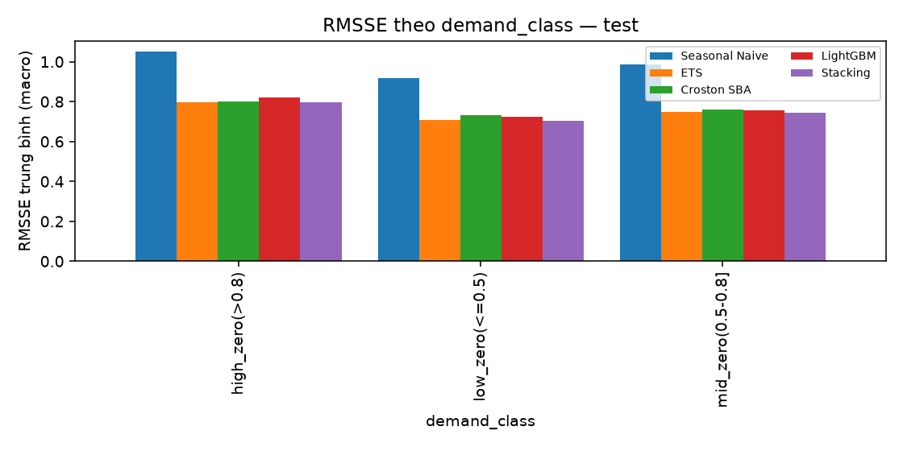
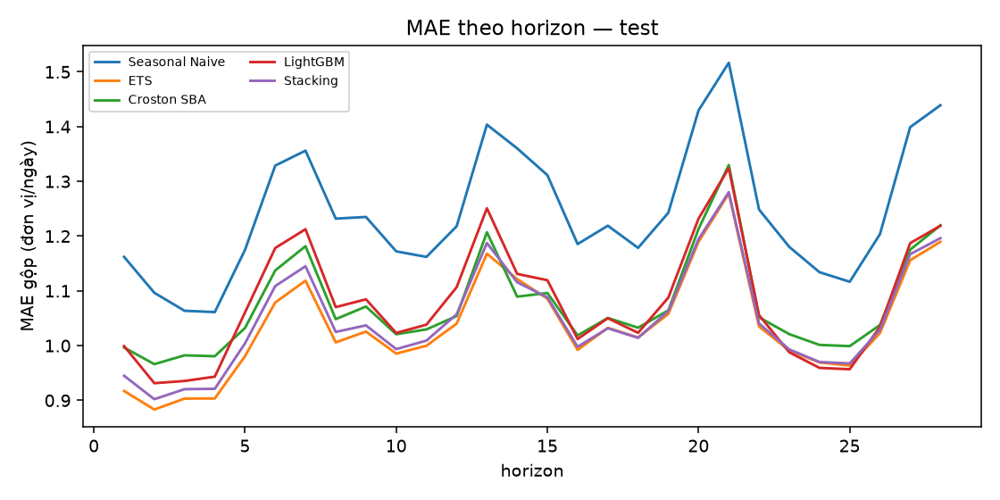
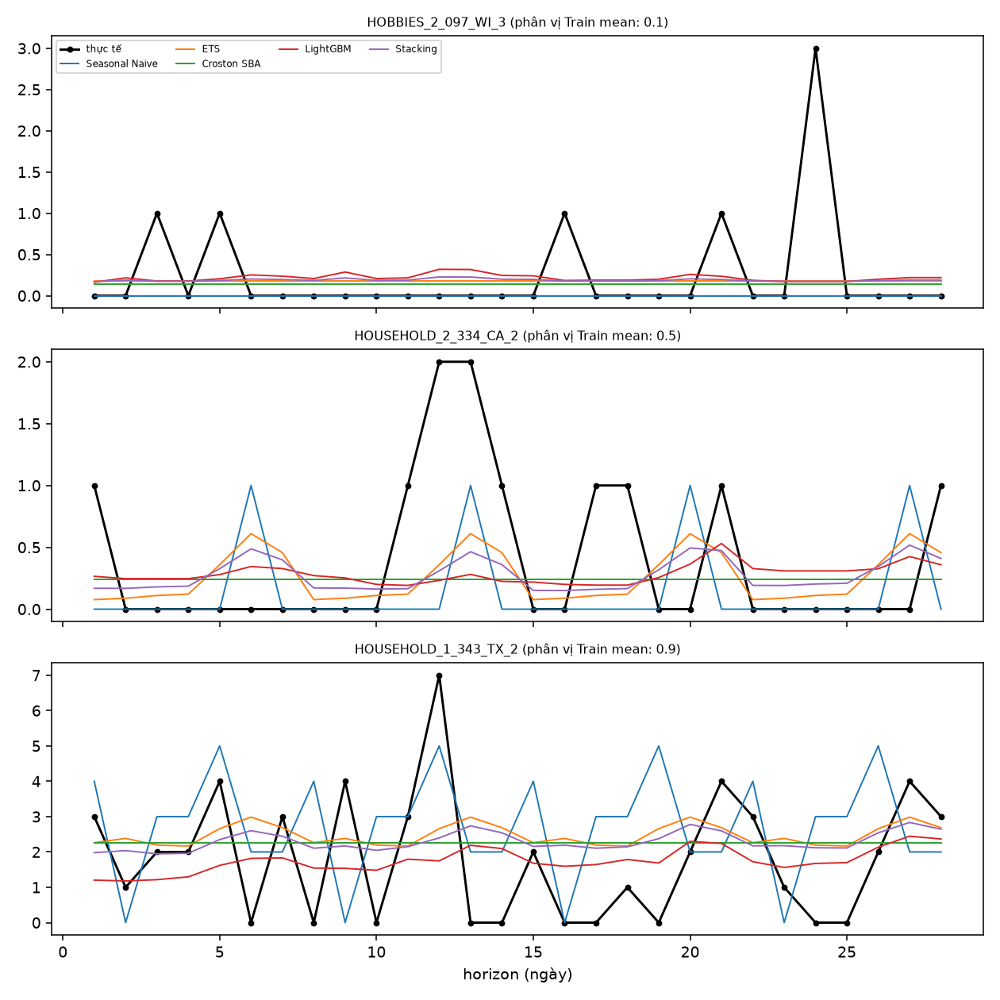
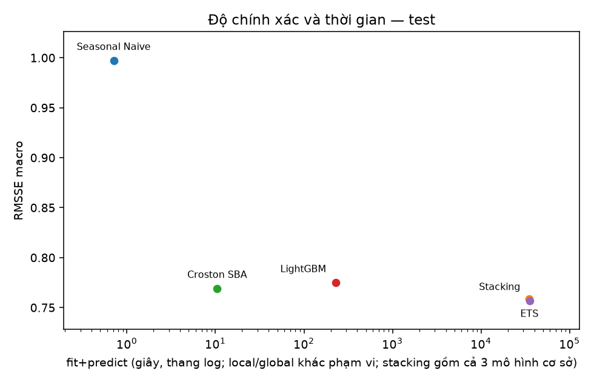
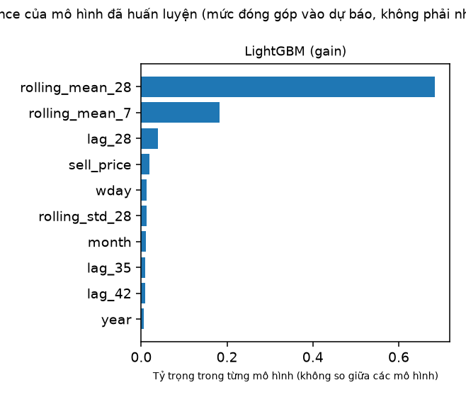

# So sánh các phương pháp dự báo nhu cầu bán lẻ trên toàn bộ dữ liệu M5

**Môn:** Phân tích dữ liệu kinh doanh — IS403.R11. **Nhóm:** 6 (Tuấn Hải, Tuấn Vũ, Thanh Tiền, Thủy Tiên, Thùy Trang). Họ tên đầy đủ và MSSV chờ đối chiếu danh sách chính thức.

> **Tình trạng bản thảo.** Bản thảo nội dung (chưa định dạng), do AI soạn từ kết quả thực nghiệm thật ngày 18/11/2026, sau khi nhóm quyết định rút gọn còn năm mô hình và chạy trên toàn bộ dữ liệu. Bản trước (mẫu 1.200 chuỗi, 7 mô hình lõi và 4 phương án mở rộng) đã được các thành viên review qua PR; bản này **chưa** được review và chưa có lượt đọc chéo toàn văn (W10). Mọi con số trong mục 4 truy được về `run_id` trong `results/full/runs/` và bảng trong `results/full/tables/` (sinh tự động bằng `scripts/build_report.py`).

## Tóm tắt

Dự báo số lượng bán hỗ trợ doanh nghiệp bán lẻ lập kế hoạch bổ sung hàng, nhưng nhu cầu ở cấp sản phẩm–cửa hàng thường gián đoạn và khó dự báo. Đồ án so sánh năm cách tiếp cận — Seasonal Naive (mốc đối chuẩn), ETS (làm mượt mũ), Croston SBA (chuyên cho hàng bán thưa), LightGBM (học máy global) và một stacking lai gộp ba mô hình trên — cho dự báo điểm 28 ngày trên **toàn bộ 30.490 chuỗi** sản phẩm–cửa hàng của Walmart M5. Năm mô hình được chọn từ một giai đoạn thử nghiệm sơ bộ với 11 mô hình trên mẫu 1.200 chuỗi. Dữ liệu chia theo thời gian (Train d_1–1885, Validation d_1886–1913, Test d_1914–1941); đặc trưng trễ lùi ít nhất 28 ngày và được kiểm thử không rò rỉ nhãn; cấu hình được khóa bằng tag `config-freeze` trước khi chạy Test, và Test chạy một lần. Hiệu quả đo bằng MAE, RMSE, RMSSE, R², thời gian chạy, và WRMSSE 12 cấp như cuộc thi M5. Trên Test, mọi mô hình giảm khoảng 22–24% macro-RMSSE so với Seasonal Naive (0,997). Stacking lai đạt macro-RMSSE thấp nhất (0,757), nhỉnh hơn ETS (0,758; chênh 0,0015, khoảng tin cậy bootstrap không chứa 0), tiếp theo Croston SBA (0,769) và LightGBM (0,775). Theo WRMSSE, stacking cũng tốt nhất (0,668), rồi LightGBM (0,722) và ETS (0,760); Croston SBA tốt ở cấp sản phẩm–cửa hàng nhưng kém nhất ở các cấp tổng hợp (WRMSSE 1,095) vì dự báo phẳng không có chu kỳ tuần. Thứ hạng giữa các mô hình gần nhau đổi giữa Validation và Test (trên Validation, ETS nhỉnh hơn stacking và LightGBM có WRMSSE thấp nhất), nên chênh lệch nhỏ không được coi là bền vững. Giới hạn: một cửa sổ Test 28 ngày, giả định giá tương lai, khác biệt input giữa mô hình cục bộ và global, nhãn Test của 1.200 chuỗi pilot đã được xem trước khi chọn mô hình, chưa đo chi phí tồn kho.

**Từ khóa:** dự báo bán lẻ, M5, nhu cầu gián đoạn, Croston SBA, ETS, LightGBM, stacking, WRMSSE.

## 1. Giới thiệu

Trong bán lẻ, quyết định bổ sung hàng cần dựa trên nhu cầu tương lai. Dự báo thấp làm tăng nguy cơ thiếu hàng; dự báo cao làm tăng tồn kho. Việc chọn phương pháp dự báo vì vậy phải cân nhắc đồng thời sai số, thời gian tính toán và khả năng giải thích.

Đồ án khảo sát bài toán dự báo số lượng bán theo ngày của từng sản phẩm tại từng cửa hàng trên dữ liệu M5 của Walmart. **Đầu vào** là lịch sử doanh số của chuỗi (sản phẩm–cửa hàng) đến ngày gốc (origin) $T$, cùng các biến bổ trợ: lịch, sự kiện, SNAP theo bang và giá bán theo tuần. **Đầu ra** là vector 28 dự báo điểm không âm $\hat y_{i,T+1},\dots,\hat y_{i,T+28}$ cho mỗi chuỗi $i$.

Bài toán có ba thách thức. (i) *Nhu cầu gián đoạn*: trên toàn bộ 30.490 chuỗi, 68,4% số ngày Train có doanh số bằng 0 và 39,1% số chuỗi có trên 80% ngày bán 0, khiến các độ đo tỷ lệ phần trăm không dùng được. (ii) *Mùa vụ tuần và khác biệt nhóm hàng*: doanh số thứ Bảy, Chủ nhật cao hơn khoảng 20% so với trung bình tuần, còn thứ Ba đến thứ Năm thấp hơn khoảng 12% (`results/tables/d07_eda_weekday.csv`, tính trên mẫu pilot). (iii) *Rò rỉ thông tin*: đặc trưng trễ và thống kê trượt phải được dựng đúng theo thời điểm thông tin sẵn có với horizon 28 ngày.

Nhóm đặt năm câu hỏi: (Q1) các mô hình cải thiện bao nhiêu so với Seasonal Naive; (Q2) hiệu quả khác nhau thế nào giữa nhóm nhu cầu (theo tỷ lệ ngày 0 trên Train), ngành hàng và bang; (Q3) mức cải thiện đi cùng chi phí tính toán nào; (Q4) cơ chế của mỗi phương pháp giải thích được hành vi dự báo nào; (Q5) thứ hạng có thay đổi khi đánh giá ở các cấp tổng hợp theo WRMSSE của M5 hay không. Đóng góp là một pipeline dùng chung chạy được trên toàn bộ dữ liệu M5, một phép so sánh năm cách tiếp cận trên cùng dữ liệu, cùng horizon và cùng độ đo (kể cả WRMSSE 12 cấp), với truy vết từ bảng/hình về dữ liệu dự báo. Đây là so sánh thuật toán trong điều kiện tài nguyên của nhóm, không phải tái lập hệ thống đội thắng cuộc thi.

## 2. Related Work

**Bối cảnh M5.** Makridakis, Spiliotis và Assimakopoulos (2022) tổng kết cuộc thi M5 Accuracy: dự báo 28 ngày doanh số của Walmart cho 42.840 chuỗi ở 12 cấp phân cấp (30.490 chuỗi sản phẩm–cửa hàng là cấp đáy), xếp hạng bằng WRMSSE. Theo bản tóm tắt của nhóm (`paper/summary.md`), đội thắng dùng LightGBM, WRMSSE 0,520, cải thiện 22,4% so với đối chuẩn thống kê tốt nhất (ES_bu); ở riêng cấp sản phẩm–cửa hàng mức cải thiện chỉ khoảng 3,4% (0,884 so với 0,915), và chỉ 7,5% đội vượt ES_bu, nên dùng học máy không tự bảo đảm tốt hơn [1]. Cửa sổ Test của đồ án (d_1914–d_1941) trùng giai đoạn chấm bảng xếp hạng công khai (public leaderboard) của M5; giai đoạn chấm cuối (private, d_1942–d_1969) không dùng ở đây.

**Phương pháp thống kê và nhu cầu gián đoạn.** ETS (làm mượt mũ có xu hướng/mùa) được lựa chọn tự động theo AICc trong khung của Hyndman và Khandakar (2008) [2]. Với chuỗi nhiều ngày 0, Croston (1972) tách ước lượng làm mượt của lượng bán khác 0 và của khoảng cách giữa các lần phát sinh nhu cầu [3]; Syntetos và Boylan (2005) chỉ ra ước lượng Croston bị chệch lên và đề xuất nhân hệ số $(1-\alpha/2)$ (SBA) [4]. Đồ án dùng bản SBA.

**Học máy và kết hợp dự báo.** Gradient boosting cộng dần các cây quyết định để giảm hàm mất mát (Friedman, 2001) [5]; LightGBM (Ke và cs., 2017) giảm chi phí huấn luyện bằng lấy mẫu theo gradient (GOSS) và gộp đặc trưng loại trừ (EFB) [6], và là họ mô hình của phần lớn đội đứng đầu M5 [1]. Bandara và cs. (2022) dùng ensemble các mô hình global cho M5, nhấn mạnh học chéo giữa các chuỗi [9]. Kết hợp nhiều dự báo là một trong những kết luận lặp lại của M5 [1]; đồ án kiểm tra một dạng kết hợp có trọng số học được (stacking) giữa mô hình cục bộ và mô hình global. XGBoost [7] và CatBoost [8] có mặt trong giai đoạn thử nghiệm sơ bộ (pilot) nhưng không vào nghiên cứu chính (mục 3.2).

**Tổng hợp và khoảng trống.** Các công trình trên khác nhau về dữ liệu, horizon, chiến lược local/global và độ đo. Đóng góp của đồ án là đặt năm mô hình đại diện cho năm cách tiếp cận (mốc ngây thơ, làm mượt mũ, chuyên cho hàng bán thưa, học máy global, kết hợp lai) trên **toàn bộ 30.490 chuỗi**, cùng cắt thời gian và cùng độ đo, kèm WRMSSE 12 cấp để đối chiếu được với M5. Nguồn [1], [6], [9] được đối chiếu qua bản tóm tắt và hồ sơ tác giả trong repo (`paper/`); các nguồn [2]–[5], [7], [8] là bài gốc kinh điển, thông tin thư mục **chưa được nhóm đọc lại toàn văn**.

## 3. Phương pháp thực hiện

### 3.1. Dữ liệu và chia thời gian

Dữ liệu gồm `calendar.csv`, `sell_prices.csv`, `sales_train_validation.csv`, `sales_train_evaluation.csv`, `sample_submission.csv`. Hai file doanh số có phần lịch sử trùng nhau (đã kiểm: d_1–d_1913 giống hệt nhau khi so theo `series_id`), nên pipeline dùng `sales_train_evaluation.csv` (d_1–d_1941). Khóa chuỗi là `series_id` = `item_id_store_id`; mọi phép nối theo khóa, không theo thứ tự dòng. Nghiên cứu chính dùng **toàn bộ 30.490 chuỗi** (`data/full_series_ids_with_class.csv`, `scripts/prepare_full_manifest.py`). Nhóm nhu cầu của mỗi chuỗi tính từ tỷ lệ ngày bán 0 trên Train (d_1–d_1885): ≤ 0,5 (21,4% số chuỗi), 0,5–0,8 (39,5%), > 0,8 (39,1%).

| Tập | Ngày | Vai trò |
|---|---|---|
| Train | d_1–d_1885 | Huấn luyện, phân nhóm nhu cầu, backtest cho stacking (mốc 1829, 1857) |
| Validation | d_1886–d_1913 | Báo cáo trước khi khóa cấu hình |
| Test | d_1914–d_1941 | Đánh giá cuối, refit trên d_1–d_1913, chạy một lần sau tag `config-freeze` |

### 3.2. Thiết kế hai giai đoạn: pilot 1.200 chuỗi rồi toàn bộ dữ liệu

Ở giai đoạn thử nghiệm sơ bộ (pilot), nhóm chạy 7 mô hình lõi (Seasonal Naive, Linear Regression, ETS, Croston, LightGBM, XGBoost, CatBoost) và 4 phương án mở rộng (Croston SBA, LightGBM tinh chỉnh bằng Optuna, LightGBM bỏ giá/sự kiện, stacking Ridge) trên một mẫu phân tầng 1.200 chuỗi (10 cửa hàng × 3 ngành hàng × 40 chuỗi, seed 42). Bảng P1 tóm tắt kết quả pilot và quyết định cho nghiên cứu chính. Tiêu chí chọn: (i) mỗi mô hình đại diện một cách tiếp cận khác nhau; (ii) bỏ mô hình trùng vai trò mà không tốt hơn (XGBoost và CatBoost ngang LightGBM nhưng chậm hơn, CatBoost ước tính cần khoảng 14 giờ CPU trên toàn bộ dữ liệu, vượt giới hạn một phiên Kaggle; Croston cổ điển kém SBA ở cả hai tập; Linear Regression kém nhất trong nhóm học máy); (iii) bỏ phương án không đứng vững trên Test (LightGBM Tuned hơn bản mặc định trên Validation nhưng không hơn trên Test) hoặc chỉ là phép thử phụ (bỏ giá/sự kiện). Stacking được giữ nhưng **dựng lại** thành bản lai gộp ETS, Croston SBA và LightGBM, vì ba mô hình cơ sở cũ đã bị bỏ và vì kết hợp mô hình cục bộ với global là phép thử chưa có ở pilot.

*Bảng P1. Kết quả pilot trên 1.200 chuỗi (macro-RMSSE) và quyết định cho nghiên cứu chính. Nguồn: `results/runs/*/metrics_summary.csv`.*

<!-- TABLE:pilot_summary -->
| Mô hình (pilot 1.200 chuỗi) | RMSSE Validation | RMSSE Test | Quyết định |
|---|---|---|---|
| ETS | 0,729 | 0,752 | chọn |
| Croston SBA | 0,743 | 0,762 | chọn |
| Croston | 0,745 | 0,764 | bỏ |
| LightGBM bỏ giá/sự kiện | 0,748 | 0,766 | bỏ |
| CatBoost | 0,763 | 0,768 | bỏ |
| LightGBM | 0,750 | 0,768 | chọn |
| XGBoost | 0,750 | 0,768 | bỏ |
| Stacking (LR + LightGBM Tuned + XGBoost + CatBoost) | 0,752 | 0,769 | chọn, dựng lại thành bản lai ETS + SBA + LightGBM |
| LightGBM Tuned | 0,745 | 0,770 | bỏ |
| Linear Regression | 0,759 | 0,776 | bỏ |
| Seasonal Naive | 0,978 | 0,997 | chọn (mốc) |
<!-- /TABLE -->

Cần lưu ý: nhãn Test của 1.200 chuỗi pilot (3,9% số chuỗi) đã được xem trước khi chốt năm mô hình, nên Test toàn bộ không còn hoàn toàn "mù" với quyết định chọn mô hình. Cấu hình của từng mô hình (tham số, đặc trưng) không đổi so với pilot.

### 3.3. Đặc trưng và chống rò rỉ

Với chuỗi $i$ và ngày $t$, đặc trưng của LightGBM là: $\text{lag}_k=y_{i,t-k}$, $k\in\{28,35,42\}$; $\text{rmean}_w=\frac1w\sum_{j=0}^{w-1}y_{i,t-28-j}$ và $\text{rstd}_w$ với $w\in\{7,28\}$ trên chuỗi đã lùi 28 ngày; `wday`, `month`, `year`; hai cặp sự kiện (tên, loại); SNAP của bang; `sell_price` và cờ `price_missing`; `dept_id`, `cat_id`, `store_id`, `state_id`. Với origin $T$ và $t\le T+28$, mọi nguồn $y$ đều $\le T$; nhãn từ $T+1$ bị che bằng NaN trước khi dựng đặc trưng. Kiểm thử (`tests/test_no_leakage.py`) làm hỏng toàn bộ nhãn sau origin rồi xác nhận đặc trưng và target không đổi. Đây là dự báo *trực tiếp* cả 28 ngày từ một origin, không đệ quy. Trên toàn bộ dữ liệu, bảng huấn luyện có khoảng 55,8 triệu dòng (Validation) và 56,6 triệu dòng (Test); cột phân loại được dựng từ mã số thay cho chuỗi chữ để vừa bộ nhớ Kaggle (30 GB), và kiểm tra cho thấy cách dựng mới cho dự báo LightGBM trùng cách cũ trên 1.200 chuỗi (lệch tối đa 1,8·10⁻¹⁵).

Giá thiếu (trước ngày sản phẩm được niêm yết) giữ NaN kèm `price_missing`, không back-fill. **Giả định giá tương lai:** pipeline dùng giá tuần của chính ngày cần dự báo (bảng giá M5 công bố đến d_1969); đây là giả định phải nêu, không phải bằng chứng nhân quả của giá. `item_id` không dùng làm biến phân loại (cardinality cao).

### 3.4. Seasonal Naive (mốc đối chuẩn)

Chu kỳ 7 ngày, lặp lại tuần cuối: $\hat y_{T+h}=y_{T-6+((h-1)\bmod 7)}$. Không có tham số học.

### 3.5. ETS

AutoETS (statsforecast) chu kỳ 7, chọn cấu trúc (error, trend, season) trong họ ETS theo AICc; mỗi chuỗi fit riêng. Cấu trúc và $\alpha,\beta,\gamma$ từng chuỗi lưu ở `diag_ets.csv`; chuỗi lỗi được fallback sang Seasonal Naive và ghi lý do ở `diag_fallbacks.csv`.

### 3.6. Croston SBA

Croston cập nhật, chỉ khi có nhu cầu $y_t>0$, lượng bán làm mượt $z\leftarrow z+\alpha(y_t-z)$ và khoảng cách làm mượt $p\leftarrow p+\alpha(q-p)$ ($q$ là số ngày từ lần có nhu cầu trước); dự báo phẳng. SBA nhân hệ số hiệu chỉnh chệch: $\hat y=(1-\alpha/2)\,z/p$, với $\alpha=0{,}1$ (`statsforecast.CrostonSBA`). Mỗi chuỗi fit riêng, chỉ dùng lịch sử doanh số.

### 3.7. LightGBM

Mô hình global (một mô hình cho toàn bộ 30.490 chuỗi), tham số mặc định thư viện, chỉ đặt `random_state=42`, số luồng và khai báo biến phân loại. Mô hình boosting có dạng $F_m(x)=F_{m-1}(x)+\eta f_m(x)$, với cây $f_m$ học phần sai số còn lại. Không early stopping, không tuning.

### 3.8. Stacking lai (ETS + Croston SBA + LightGBM)

Dự báo cuối là $\hat y=\max\big(0,\ \beta_0+\beta_1\hat y^{\text{ETS}}+\beta_2\hat y^{\text{SBA}}+\beta_3\hat y^{\text{LGBM}}\big)$. Hệ số $\beta$ được khớp bằng hồi quy Ridge trên **dự báo ngoài mẫu trong Train**: ba mô hình cơ sở được fit đến mốc 1829 và 1857 rồi dự báo 28 ngày kế tiếp (nhãn tới d_1885, không chạm Validation hay Test), cho 2 × 30.490 × 28 dòng. Hệ số phạt alpha chọn trong {0,1; 1; 10; 100; 1000} bằng leave-one-origin-out trên hai mốc. Bộ gộp đã khớp được giữ nguyên rồi áp vào dự báo Validation và Test của ba mô hình cơ sở, nên điểm Validation/Test không dùng để khớp bộ gộp.

### 3.9. Local, global và hậu xử lý

Seasonal Naive, ETS, Croston SBA là *local* (chỉ thấy lịch sử doanh số của chính chuỗi); LightGBM là *global* (thấy thêm giá, lịch, SNAP, nhóm hàng và đặc trưng trễ của mọi chuỗi); stacking gộp cả hai. Chênh lệch giữa hai nhóm vì vậy gộp hiệu ứng của thuật toán và của thông tin ngoại sinh. Mọi dự báo được cắt $\max(\hat y,0)$, không làm tròn; số dự báo âm trước khi cắt ghi ở `timings.json`.

## 4. Thực nghiệm và đánh giá

### 4.1. Tiêu chí đánh giá

Với $e_{i,h}=y_{i,T+h}-\hat y_{i,T+h}$ và $H=28$:

- $\mathrm{MAE}_i=\frac1H\sum_h|e_{i,h}|$ — cùng đơn vị với doanh số (sản phẩm/ngày).
- $\mathrm{RMSE}_i=\sqrt{\frac1H\sum_h e_{i,h}^2}$ — phạt nặng sai số lớn.
- $\mathrm{RMSSE}_i=\sqrt{\dfrac{\frac1H\sum_h e_{i,h}^2}{\frac1{n-s_i}\sum_{t=s_i+1}^{n}(y_{i,t}-y_{i,t-1})^2}}$ với $n=T$, $s_i$ là ngày bán khác 0 đầu tiên; mẫu số là sai số naïve một bước trên lịch sử Train. $<1$ nghĩa là sai số dự báo nhỏ hơn sai số naïve một bước *trong mẫu Train*.
- $R^2_i=1-\mathrm{SSE}_i/\mathrm{SST}_i$ trên 28 ngày đánh giá; có thể âm.
- **WRMSSE** (như M5): dự báo cấp đáy được cộng lên 12 cấp (tổng; bang; cửa hàng; ngành hàng; nhóm hàng; bang × ngành; bang × nhóm; cửa hàng × ngành; cửa hàng × nhóm; sản phẩm; sản phẩm × bang; sản phẩm × cửa hàng), tổng cộng 42.840 chuỗi; mỗi chuỗi có RMSSE riêng; trọng số là doanh thu (số lượng × giá) 28 ngày cuối trước origin, chuẩn hóa trong từng cấp; WRMSSE là trung bình 12 cấp (`scripts/wrmsse.py`). Kiểm tra cài đặt: dự báo hoàn hảo cho 0, Seasonal Naive trên cửa sổ Test cho 0,870, dự báo toàn 0 cho 5,447.

**Chính sách (chốt trước khi chạy Test).** Mẫu số RMSSE bằng 0 → RMSSE không xác định; nhãn đánh giá hằng → $R^2$ không xác định. Các trường hợp này **không** thay bằng epsilon: ghi NaN kèm lý do, loại khỏi trung bình và đếm riêng. Tổng hợp *macro* là trung bình theo chuỗi; MAE/RMSE *pooled* tính trên toàn bộ cặp (chuỗi, ngày). Xếp hạng chính theo macro-RMSSE trên 30.490 chuỗi (mọi chuỗi đều có RMSSE xác định ở cả Validation và Test); WRMSSE báo cáo bên cạnh để trả lời Q5.

**Runtime.** Mô hình cục bộ: tổng thời gian fit+predict từng chuỗi (đơn luồng mỗi chuỗi, 4 tiến trình song song). LightGBM: thời gian fit+predict toàn bộ dữ liệu với 4 luồng; dựng đặc trưng và đọc dữ liệu tính riêng. Stacking: thời gian khớp bộ gộp, cộng thêm chi phí của ba mô hình cơ sở. Hai nhóm không cùng phạm vi nên không so trực tiếp.

### 4.2. Môi trường và các run

Các mô hình cơ sở chạy trên Kaggle (CPU 4 lõi, khoảng 30 GB RAM, Python 3.13; numpy 2.1.3, pandas 2.3.3, scikit-learn 1.6.1, statsforecast 2.1.1, LightGBM 4.6.0, đúng các phiên bản ghim trong `requirements.txt`), mỗi job một notebook (`notebooks/06a–06d`, `scripts/kaggle_full_run.py`): Validation, Test và hai backtest trong Train. Cả bốn job dùng cùng mã (commit `c8ba5c8`, chính là commit gắn tag `config-freeze`), cùng năm tệp CSV (SHA-256 trùng nhau, ghi ở `data_sha256.json` của từng run) và cùng danh sách 30.490 chuỗi (hash `56a6267c…`). Stacking (khớp bộ gộp và áp vào Validation/Test) chạy trên máy cục bộ vì chỉ tốn vài giây. Không chuỗi nào phải fallback sang Seasonal Naive.

*Bảng 1. Các run của nghiên cứu chính. Nguồn: `results/full/runs/*/environment.json`.*

<!-- TABLE:runs -->
| run_id | split | origin | mô hình | SHA mã | CPU | Python |
|---|---|---|---|---|---|---|
| tes-20261118T054917Z-c8ba5c8 | test | d_1913 | Seasonal Naive, ETS, Croston SBA, LightGBM | c8ba5c8 | 4 | 3.13.18 |
| tes-20261118T083859Z-867b564-stack | test | d_1913 | Stacking lai | 867b564 | máy cục bộ | n/a |
| val-20261118T054238Z-c8ba5c8 | validation | d_1885 | Seasonal Naive, ETS, Croston SBA, LightGBM | c8ba5c8 | 4 | 3.13.18 |
| val-20261118T083718Z-867b564-stack | validation | d_1885 | Stacking lai | 867b564 | máy cục bộ | n/a |
<!-- /TABLE -->

### 4.3. Kết quả tổng thể (Q1, Q5)

*Bảng 2. Validation (d_1886–d_1913) — macro trên 30.490 chuỗi. Nguồn: `results/full/tables/validation/validation_overall.csv`.*

<!-- TABLE:val_overall -->
| Mô hình | MAE (macro) | RMSE (macro) | RMSSE (macro) | R² (macro) | So Seasonal Naive (RMSSE) | fit+predict (s) |
|---|---|---|---|---|---|---|
| Seasonal Naive | 1,232 | 1,740 | 0,976 | −1,535 | +0,0% | 0,7 |
| ETS | 1,039 | 1,346 | 0,737 | −0,242 | −24,5% | 34832,2 |
| Croston SBA | 1,085 | 1,391 | 0,759 | −0,345 | −22,2% | 8,7 |
| LightGBM | 1,063 | 1,354 | 0,757 | −0,346 | −22,4% | 255,0 |
| Stacking lai | 1,046 | 1,332 | 0,738 | −0,243 | −24,4% | 15,2 |
<!-- /TABLE -->

*Bảng 3. Test (d_1914–d_1941, refit trên d_1–d_1913, chạy một lần sau tag `config-freeze`). Nguồn: `results/full/tables/test/test_overall.csv`. Thời gian của stacking chỉ gồm bước khớp bộ gộp (mục 4.5).*

<!-- TABLE:test_overall -->
| Mô hình | MAE (macro) | RMSE (macro) | RMSSE (macro) | R² (macro) | So Seasonal Naive (RMSSE) | fit+predict (s) |
|---|---|---|---|---|---|---|
| Seasonal Naive | 1,244 | 1,752 | 0,997 | −1,371 | +0,0% | 0,7 |
| ETS | 1,040 | 1,360 | 0,758 | −0,184 | −23,9% | 35121,1 |
| Croston SBA | 1,075 | 1,393 | 0,769 | −0,422 | −22,9% | 10,5 |
| LightGBM | 1,079 | 1,386 | 0,775 | −0,422 | −22,3% | 228,4 |
| Stacking lai | 1,050 | 1,351 | 0,757 | −0,235 | −24,1% | 12,1 |
<!-- /TABLE -->

*Bảng 4. Macro so với gộp (pooled) và số chuỗi có $R^2$ không xác định (Test).*

<!-- TABLE:test_pooled -->
| Mô hình | RMSE macro | RMSE gộp | MAE macro | R² không xác định (số chuỗi) | RMSSE không xác định (số chuỗi) |
|---|---|---|---|---|---|
| Seasonal Naive | 1,752 | 2,677 | 1,244 | 812 | 0 |
| ETS | 1,360 | 2,174 | 1,040 | 812 | 0 |
| Croston SBA | 1,393 | 2,232 | 1,075 | 812 | 0 |
| LightGBM | 1,386 | 2,209 | 1,079 | 812 | 0 |
| Stacking lai | 1,351 | 2,124 | 1,050 | 812 | 0 |
<!-- /TABLE -->

<!-- TABLE:test_negraw -->
| Mô hình | Số dự báo âm trước khi cắt về 0 (trên 853.720) |
|---|---|
| Seasonal Naive | 0 |
| ETS | 16474 |
| Croston SBA | 0 |
| LightGBM | 0 |
| Stacking lai | 0 |
<!-- /TABLE -->

**Trả lời Q1 — so với Seasonal Naive.** Cả bốn mô hình giảm macro-RMSSE khoảng 22–24% so với Seasonal Naive trên Test (Bảng 3) và Validation (Bảng 2). Seasonal Naive có RMSSE gần 1, tức sai số của nó trên giai đoạn đánh giá cùng cỡ với mẫu số của RMSSE. Tỷ lệ chuỗi có MAE thấp hơn Seasonal Naive chỉ 60–65% (Bảng 8), nên cải thiện đến từ việc giảm sai số trung bình hơn là thắng trên mọi chuỗi. R² macro đều âm (Bảng 3): 28 ngày đánh giá của chuỗi thưa có phương sai nhỏ nên mọi mô hình đều kém mốc trung bình của nhãn; 812 chuỗi Test (1.587 trên Validation) có nhãn hằng nên R² không xác định.

**Thứ hạng và độ chắc chắn.** Trên Test, stacking lai (0,757) và ETS (0,758) dẫn đầu, Croston SBA (0,769) và LightGBM (0,775) theo sau. Với 30.490 chuỗi, khoảng tin cậy bootstrap rất hẹp (Bảng 5, 6): stacking thấp hơn ETS 0,0015 với khoảng không chứa 0, Croston SBA thấp hơn LightGBM 0,0057. Tuy vậy, trên Validation thứ tự hai cặp này đảo lại: ETS thấp hơn stacking 0,0009 (khoảng tin cậy sát 0) và LightGBM thấp hơn Croston SBA 0,0020 (khoảng không chứa 0). Khoảng tin cậy chỉ phản ánh biến thiên giữa các chuỗi trong *một* cửa sổ 28 ngày, nên các chênh lệch cỡ 0,001–0,006 không được coi là bền vững; kết luận vững là bốn mô hình tốt hơn rõ Seasonal Naive, cặp {ETS, stacking} tốt hơn cặp {Croston SBA, LightGBM} khoảng 0,01–0,02 ở cả hai cửa sổ.

*Bảng 5. Test: macro-RMSSE, khoảng tin cậy 95% bootstrap (2.000 lần lấy lại 30.490 chuỗi, seed 42) và chênh lệch cặp so với ETS (dương = kém ETS). Nguồn: `results/full/tables/test/test_bootstrap_ci.csv`.*

<!-- TABLE:test_bootstrap -->
| Mô hình | RMSSE (macro) | KTC 95% | Chênh so với ETS | KTC 95% của chênh lệch |
|---|---|---|---|---|
| Seasonal Naive | 0,997 | [0,992; 1,002] | +0,2388 | [+0,2359; +0,2417] |
| ETS | 0,758 | [0,755; 0,762] | — | — |
| Croston SBA | 0,769 | [0,765; 0,773] | +0,0107 | [+0,0093; +0,0121] |
| LightGBM | 0,775 | [0,771; 0,779] | +0,0164 | [+0,0152; +0,0177] |
| Stacking lai | 0,757 | [0,753; 0,761] | −0,0015 | [−0,0020; −0,0009] |
<!-- /TABLE -->

*Bảng 6. Chênh lệch cặp giữa các mô hình gần nhau (âm = mô hình thứ nhất tốt hơn). Nguồn: `*_bootstrap_pairs.csv`.*

<!-- TABLE:bootstrap_pairs -->
| Tập | Cặp (thứ nhất − thứ hai) | Chênh | KTC 95% | Khoảng chứa 0 |
|---|---|---|---|---|
| Validation | Croston SBA − LightGBM | +0,0020 | [+0,0005; +0,0036] | không |
| Validation | Stacking lai − LightGBM | −0,0191 | [−0,0201; −0,0180] | không |
| Validation | Stacking lai − Croston SBA | −0,0211 | [−0,0226; −0,0198] | không |
| Test | Croston SBA − LightGBM | −0,0057 | [−0,0070; −0,0045] | không |
| Test | Stacking lai − LightGBM | −0,0179 | [−0,0187; −0,0171] | không |
| Test | Stacking lai − Croston SBA | −0,0122 | [−0,0132; −0,0111] | không |
<!-- /TABLE -->

**Trả lời Q5 — WRMSSE và các cấp tổng hợp.** Bảng 6a và 6b cho WRMSSE và RMSSE có trọng số ở bốn cấp tiêu biểu. Thứ hạng đổi mạnh so với macro-RMSSE cấp đáy: Croston SBA tốt ở cấp sản phẩm–cửa hàng (cấp 12: 0,862, gần ETS và LightGBM) nhưng kém nhất ở mọi cấp tổng hợp (cấp 1–9: 1,11–1,22 trên Test, tệ hơn cả Seasonal Naive), vì dự báo phẳng của từng chuỗi khi cộng lại vẫn phẳng, mất hẳn chu kỳ tuần của doanh số tổng. Ngược lại, LightGBM — kém nhất trong bốn mô hình ở cấp đáy theo macro-RMSSE trên Test — lại rất tốt ở các cấp tổng hợp (cấp 1: 0,610 trên Test, 0,330 trên Validation), vì nó học chung mức và mùa vụ của mọi chuỗi. Stacking lai tận dụng cả hai: WRMSSE Test 0,668, thấp nhất, với cấp 1 bằng 0,505 và cấp 12 bằng 0,834. Trên Validation, LightGBM có WRMSSE thấp nhất (0,591) và stacking xếp thứ hai (0,715); bộ gộp được khớp theo sai số bình phương ở cấp đáy nên không tối ưu trực tiếp cho các cấp tổng hợp. Cửa sổ Test của đồ án trùng giai đoạn chấm bảng xếp hạng công khai của M5, nhưng điểm ở đây không phải bài nộp thi.

*Bảng 6a. WRMSSE (Validation) và RMSSE có trọng số ở bốn cấp. Nguồn: `results/full/tables/validation/validation_wrmsse.csv`.*

<!-- TABLE:val_wrmsse -->
| Mô hình | WRMSSE | Cấp 1 (tổng) | Cấp 3 (cửa hàng) | Cấp 9 (cửa hàng × nhóm hàng) | Cấp 12 (sản phẩm × cửa hàng) |
|---|---|---|---|---|---|
| Seasonal Naive | 0,923 | 0,668 | 0,825 | 1,029 | 1,126 |
| ETS | 0,724 | 0,527 | 0,649 | 0,795 | 0,865 |
| Croston SBA | 1,121 | 1,206 | 1,134 | 1,156 | 0,873 |
| LightGBM | 0,591 | 0,330 | 0,501 | 0,664 | 0,854 |
| Stacking lai | 0,715 | 0,569 | 0,664 | 0,763 | 0,845 |
<!-- /TABLE -->

*Bảng 6b. WRMSSE (Test). Nguồn: `results/full/tables/test/test_wrmsse.csv` (đủ 12 cấp).*

<!-- TABLE:test_wrmsse -->
| Mô hình | WRMSSE | Cấp 1 (tổng) | Cấp 3 (cửa hàng) | Cấp 9 (cửa hàng × nhóm hàng) | Cấp 12 (sản phẩm × cửa hàng) |
|---|---|---|---|---|---|
| Seasonal Naive | 0,870 | 0,751 | 0,799 | 0,892 | 1,100 |
| ETS | 0,760 | 0,687 | 0,731 | 0,790 | 0,845 |
| Croston SBA | 1,095 | 1,186 | 1,144 | 1,118 | 0,862 |
| LightGBM | 0,722 | 0,610 | 0,685 | 0,759 | 0,857 |
| Stacking lai | 0,668 | 0,505 | 0,620 | 0,730 | 0,834 |
<!-- /TABLE -->

### 4.4. Theo nhóm nhu cầu, ngành hàng và bang (Q2)

*Bảng 7a. RMSSE macro theo nhóm tỷ lệ ngày 0 trên Train (Test). Nhóm: ≤ 0,5 (6.530 chuỗi); 0,5–0,8 (12.053); > 0,8 (11.907).*

<!-- TABLE:test_demand_class_rmsse -->
| demand_class | Seasonal Naive | ETS | Croston SBA | LightGBM | Stacking lai |
|---|---|---|---|---|---|
| high_zero(>0.8) | 1,051 | 0,795 | 0,801 | 0,820 | 0,796 |
| low_zero(<=0.5) | 0,918 | 0,708 | 0,730 | 0,725 | 0,705 |
| mid_zero(0.5-0.8] | 0,987 | 0,750 | 0,759 | 0,757 | 0,746 |
<!-- /TABLE -->

*Bảng 7b. RMSSE macro theo ngành hàng (Test).*

<!-- TABLE:test_cat_rmsse -->
| cat_id | Seasonal Naive | ETS | Croston SBA | LightGBM | Stacking lai |
|---|---|---|---|---|---|
| FOODS | 1,003 | 0,777 | 0,786 | 0,790 | 0,772 |
| HOBBIES | 0,982 | 0,736 | 0,741 | 0,756 | 0,738 |
| HOUSEHOLD | 0,997 | 0,745 | 0,761 | 0,764 | 0,747 |
<!-- /TABLE -->

*Bảng 7c. RMSSE macro theo bang (Test).*

<!-- TABLE:test_state_rmsse -->
| state | Seasonal Naive | ETS | Croston SBA | LightGBM | Stacking lai |
|---|---|---|---|---|---|
| CA | 1,013 | 0,769 | 0,784 | 0,784 | 0,768 |
| TX | 0,954 | 0,729 | 0,736 | 0,748 | 0,728 |
| WI | 1,019 | 0,774 | 0,783 | 0,789 | 0,771 |
<!-- /TABLE -->

Ở nhóm gián đoạn mạnh (> 0,8), ba mô hình cục bộ và stacking sát nhau (ETS 0,795, stacking 0,796, Croston SBA 0,801) và đều tốt hơn rõ LightGBM (0,820). Ở nhóm ít số 0 (≤ 0,5), stacking (0,705) và ETS (0,708) dẫn, LightGBM (0,725) đứng thứ ba và Croston SBA kém nhất (0,730) vì dự báo phẳng bỏ qua chu kỳ tuần, vốn rõ hơn ở hàng bán đều. Theo ngành hàng, HOBBIES có sai số chuẩn hóa thấp nhất, FOODS cao nhất; theo bang, TX thấp nhất. Các khác biệt giữa nhóm là mô tả, không diễn giải nhân quả.

*Độ bền của phân nhóm.* Nhóm nhu cầu tính từ tỷ lệ ngày 0 trên toàn bộ d_1–d_1885 nên gồm cả các ngày 0 *trước lần bán đầu tiên*: 23.511/30.490 chuỗi có đoạn 0 đầu (trung vị 452 ngày). Tính lại chỉ sau lần bán đầu tiên, 7.341 chuỗi (24%) đổi nhóm và nhóm > 0,8 giảm từ 11.907 xuống 7.486 chuỗi. Bảng 7d cho thấy kết luận không đổi: ở nhóm > 0,8 tính lại, ETS (0,800), stacking (0,805) và Croston SBA (0,806) vẫn tốt hơn LightGBM (0,837).

*Bảng 7d. RMSSE macro theo nhóm tính sau lần bán đầu tiên (Test; kiểm tra độ bền). Nguồn: `scripts/robustness_classes.py`.*

<!-- TABLE:test_class_after_first_sale -->
| Nhóm (sau lần bán đầu tiên) | Số chuỗi | Seasonal Naive | ETS | Croston SBA | LightGBM | Stacking lai |
|---|---|---|---|---|---|---|
| high_zero(>0.8) | 7486 | 1,062 | 0,800 | 0,806 | 0,837 | 0,805 |
| low_zero(<=0.5) | 9919 | 0,942 | 0,728 | 0,745 | 0,740 | 0,723 |
| mid_zero(0.5-0.8] | 13085 | 1,002 | 0,758 | 0,766 | 0,765 | 0,755 |
<!-- /TABLE -->

*Hình 1. RMSSE theo nhóm nhu cầu (Test).*

*Bảng 8. Tỷ lệ chuỗi có MAE thấp hơn Seasonal Naive và chênh lệch trung vị (Test).*

<!-- TABLE:test_winrate -->
| Mô hình | Tỷ lệ chuỗi thắng Seasonal Naive | Tỷ lệ hòa | Chênh MAE trung vị |
|---|---|---|---|
| ETS | 0,650 | 0,004 | −0,085 |
| Croston SBA | 0,641 | 0,006 | −0,087 |
| LightGBM | 0,600 | 0,000 | −0,067 |
| Stacking lai | 0,630 | 0,000 | −0,079 |
<!-- /TABLE -->

**Theo thứ trong tuần và horizon.** Mọi mô hình sai nhiều hơn vào thứ Bảy và Chủ nhật (ngày bán cao nên sai số tuyệt đối lớn), Seasonal Naive sai nhiều nhất (Bảng 9). Sai số tăng từ tuần 1 đến tuần 3 rồi giảm ở tuần 4 (MAE trung bình theo tuần của ETS: 0,969; 1,049; 1,093; 1,047). ETS có MAE gộp thấp nhất ở 22/28 horizon (`test_mae_by_horizon.csv`); Croston SBA thấp nhất ở horizon 14.

*Bảng 9. MAE gộp theo thứ trong tuần (Test).*

<!-- TABLE:test_weekday -->
| Thứ | Seasonal Naive | ETS | Croston SBA | LightGBM | Stacking lai |
|---|---|---|---|---|---|
| Monday | 1,239 | 1,011 | 1,048 | 1,061 | 1,025 |
| Tuesday | 1,174 | 0,973 | 1,019 | 1,004 | 0,983 |
| Wednesday | 1,147 | 0,973 | 1,014 | 0,992 | 0,979 |
| Thursday | 1,130 | 0,970 | 1,010 | 0,990 | 0,978 |
| Friday | 1,210 | 1,025 | 1,047 | 1,072 | 1,038 |
| Saturday | 1,390 | 1,148 | 1,183 | 1,212 | 1,164 |
| Sunday | 1,418 | 1,177 | 1,205 | 1,222 | 1,184 |
<!-- /TABLE -->

*Bảng 10. MAE gộp theo horizon (Test), một số ngày tiêu biểu.*

<!-- TABLE:test_horizon -->
| horizon | Seasonal Naive | ETS | Croston SBA | LightGBM | Stacking lai |
|---|---|---|---|---|---|
| 1 | 1,162 | 0,917 | 0,997 | 0,999 | 0,945 |
| 7 | 1,356 | 1,119 | 1,182 | 1,213 | 1,145 |
| 14 | 1,360 | 1,122 | 1,089 | 1,131 | 1,116 |
| 21 | 1,517 | 1,278 | 1,330 | 1,324 | 1,280 |
| 28 | 1,439 | 1,190 | 1,220 | 1,219 | 1,196 |
<!-- /TABLE -->

*Hình 2. MAE gộp theo horizon 1–28 (Test).*

*Hình 3. Ví dụ thực tế–dự báo cho ba chuỗi chọn theo phân vị 10/50/90 của doanh số trung bình trên Train (quy tắc khách quan).*

### 4.5. Chi phí tính toán (Q3)

Trên Test, Seasonal Naive mất dưới 1 giây và Croston SBA khoảng 10 giây (tổng CPU của 30.490 chuỗi). LightGBM mất khoảng 228 giây fit+predict với 4 luồng, cộng khoảng 46 giây dựng bảng đặc trưng 56 triệu dòng. ETS là phần đắt nhất: khoảng 35.100 giây CPU tổng, tức khoảng 8.800 giây thực (gần 2,5 giờ) với 4 tiến trình; mỗi backtest cho stacking tốn thêm thời gian tương tự. Stacking chỉ tốn khoảng 12 giây cho bộ gộp, nhưng cần đủ ba mô hình cơ sở nên tổng chi phí của nó lớn hơn ETS. Đổi lại, trên Test stacking giảm WRMSSE từ 0,760 (ETS) xuống 0,668, còn Croston SBA đạt macro-RMSSE chỉ kém ETS 0,011 với chi phí gần bằng 0. Chưa có chi phí tồn kho nên không kết luận về lợi ích kinh doanh.

*Hình 4. Độ chính xác và thời gian (Test); điểm của stacking gồm cả chi phí ba mô hình cơ sở.*

### 4.6. Cơ chế (Q4)

*ETS* chọn toàn bộ cấu trúc có sai số cộng: ETS(A,N,A) 52,4% số chuỗi, ETS(A,N,N) 35,8%, các cấu trúc có xu hướng tắt dần khoảng 11% (Bảng 11). α trung bình 0,066 (trung vị 0,041): làm mượt rất mạnh nên mức dự báo ổn định, phù hợp chuỗi thưa nhiều nhiễu; γ trung vị gần 0 nên chu kỳ tuần gần như cố định. Khoảng 40% chuỗi không chọn thành phần mùa. Dự báo cộng của ETS có thể âm: 16.474 điểm dự báo Test (1,9%) phải cắt về 0.

*Bảng 11. Cấu trúc ETS được chọn (run Validation).*

<!-- TABLE:ets_structure -->
| Cấu trúc | Số chuỗi | Tỷ lệ |
|---|---|---|
| ETS(A,N,A) | 15.989 | 52,4% |
| ETS(A,N,N) | 10.917 | 35,8% |
| ETS(A,Ad,A) | 2.319 | 7,6% |
| ETS(A,Ad,N) | 1.103 | 3,6% |
| ETS(A,A,N) | 94 | 0,3% |
| ETS(A,A,A) | 68 | 0,2% |

*α/β/γ (số chuỗi có tham số, trung bình, trung vị, lớn nhất):*

| thống kê | ets_alpha | ets_beta | ets_gamma |
|---|---|---|---|
| count | 30.490 | 3.584 | 18.376 |
| mean | 0,066 | 0,004 | 0,007 |
| 50% | 0,041 | 0,001 | 0,000 |
| max | 1,000 | 0,060 | 0,283 |
<!-- /TABLE -->

*Croston SBA* chỉ cập nhật khi có nhu cầu và dự báo phẳng $(1-\alpha/2)z/p$: hợp với hàng bán thưa (gần ETS ở nhóm > 0,8) nhưng không bắt chu kỳ tuần, nên kém ở hàng bán đều và đặc biệt ở các cấp tổng hợp (mục 4.3).

*LightGBM* tập trung importance vào `rolling_mean_28` (68,5% gain) và `rolling_mean_7` (18,2%); giá, thứ trong tuần và tháng đóng góp nhỏ (Bảng 12, Hình 5). Dự báo chủ yếu là mức doanh số trượt điều chỉnh theo lịch, nên mô hình học tốt mặt bằng chung và chu kỳ của tổng (cấp tổng hợp) nhưng kém ETS ở từng chuỗi thưa. Importance chỉ cho biết đóng góp vào dự báo, không phải tác động nhân quả.

*Bảng 12. Importance (gain) của LightGBM (run Validation).*

<!-- TABLE:importance -->
| Đặc trưng | Tỷ trọng gain |
|---|---|
| rolling_mean_28 | 68,5% |
| rolling_mean_7 | 18,2% |
| lag_28 | 3,9% |
| sell_price | 1,9% |
| wday | 1,3% |
| rolling_std_28 | 1,2% |
| month | 1,1% |
| lag_35 | 0,9% |
<!-- /TABLE -->

*Hình 5. Importance của LightGBM (run Validation).*

*Stacking lai* gán trọng số ETS 0,543, LightGBM 0,371, Croston SBA 0,138 và hệ số chặn gần 0 (Bảng 13). Tổng trọng số khoảng 1,05, tức bộ gộp gần như một trung bình có trọng số. ETS và Croston SBA tương quan cao nên SBA nhận trọng số nhỏ; phần LightGBM mang thông tin global và chu kỳ tuần mà hai mô hình cục bộ thiếu. Alpha được chọn ở biên dưới của lưới (0,1), nhưng sai số kiểm chéo giữa các alpha gần như bằng nhau (2,23535 đến 2,23536), nên lựa chọn này không ảnh hưởng kết quả. Chỉ có hai mốc backtest nên trọng số chưa được kiểm độ ổn định theo thời gian.

*Bảng 13. Hệ số của bộ gộp stacking (khớp một lần trên dự báo ngoài mẫu trong Train, dùng chung cho Validation và Test).*

<!-- TABLE:stack_coef -->
| Run | alpha | ETS | Croston SBA | LightGBM | hệ số chặn | Dòng OOF |
|---|---|---|---|---|---|---|
| tes-20261118T083859Z-867b564-stack | 0,1 | 0,5429 | 0,1377 | 0,3713 | −0,0050 | 1.707.440 |
| val-20261118T083718Z-867b564-stack | 0,1 | 0,5429 | 0,1377 | 0,3713 | −0,0050 | 1.707.440 |
<!-- /TABLE -->

### 4.7. So với pilot 1.200 chuỗi

Trên Test, macro-RMSSE toàn bộ dữ liệu cao hơn pilot khoảng 0,006–0,007 cho ETS, Croston SBA và LightGBM (0,758 so với 0,752; 0,769 so với 0,762; 0,775 so với 0,768), còn Seasonal Naive không đổi (0,997). Thứ tự giữa bốn mô hình cơ sở giống pilot. Mẫu pilot lệch nhẹ về phía chuỗi gián đoạn (43,3% so với 39,1% chuỗi có trên 80% ngày bán 0), nên kết quả toàn bộ dữ liệu là ước lượng đại diện hơn; việc thứ hạng giữ nguyên cho thấy mẫu 1.200 chuỗi đủ để chọn mô hình.

**Giới hạn của thực nghiệm.** (i) Một cửa sổ Test 28 ngày; các chênh lệch nhỏ đổi chiều giữa Validation và Test. (ii) Khác biệt input giữa mô hình cục bộ (chỉ lịch sử doanh số) và LightGBM (thêm giá/lịch/SNAP/nhóm). (iii) Giả định giá ngày dự báo được biết trước. (iv) Khoảng tin cậy bootstrap chỉ phản ánh biến thiên giữa các chuỗi trong một cửa sổ; các chuỗi không độc lập (cùng cửa hàng, cùng ngày) nên khoảng thực tế rộng hơn. (v) Runtime local và global khác phạm vi; stacking chạy trên máy khác với các mô hình cơ sở. (vi) Nhãn Test của 1.200 chuỗi pilot (3,9% số chuỗi) đã được xem trước khi chọn năm mô hình; tag `config-freeze` hiện tại được tạo lại ngày 18/11/2026 cho cấu hình toàn bộ dữ liệu (tag cũ của pilot đã gỡ), các SHA của run pilot ghi ở `configs/freeze.yaml` và `results/pre_rewrite_sha_map.csv`. (vii) Bộ gộp stacking chỉ có hai mốc backtest và được khớp theo sai số cấp đáy, không theo WRMSSE. (viii) Phân nhóm nhu cầu tính cả ngày 0 trước lần bán đầu tiên (độ bền ở Bảng 7d). (ix) Việc kiểm tra bằng AI không thay thế đối chiếu và review của các thành viên.

## 5. Kết luận và hướng phát triển

Trên toàn bộ 30.490 chuỗi Walmart M5 với horizon 28 ngày: (Q1) cả bốn mô hình giảm khoảng 22–24% macro-RMSSE so với Seasonal Naive; (Q2) ở hàng bán thưa, các mô hình cục bộ và stacking tốt hơn rõ LightGBM, còn ở hàng bán đều Croston SBA kém nhất vì không có chu kỳ tuần; (Q3) Croston SBA gần như không tốn thời gian, LightGBM mất vài phút, ETS mất khoảng 2,5 giờ với 4 tiến trình, và stacking cần cả ba; (Q4) cơ chế phù hợp: làm mượt mạnh (ETS), cập nhật theo lần có nhu cầu (Croston SBA), mức doanh số trượt chi phối dự báo global (LightGBM); (Q5) ở các cấp tổng hợp thứ hạng đổi mạnh: LightGBM vượt các mô hình cục bộ, Croston SBA kém nhất. Stacking lai — gộp ETS, Croston SBA và LightGBM — là phương án cân bằng nhất trên Test: macro-RMSSE thấp nhất (0,757) và WRMSSE thấp nhất (0,668); tuy nhiên chênh lệch với ETS ở cấp đáy rất nhỏ và đổi chiều trên Validation.

Hướng phát triển: kiểm định cuốn chiếu (rolling-origin) trên nhiều mùa để xem thứ hạng có ổn định không; khớp bộ gộp stacking theo WRMSSE hoặc theo từng cấp, thêm mốc backtest; thêm chu kỳ tuần cho Croston (ví dụ nhân hệ số mùa) để khắc phục điểm yếu ở cấp tổng hợp; mô phỏng quyết định tồn kho với chi phí thực; dự báo xác suất.

## Tài liệu tham khảo

1. Makridakis, S., Spiliotis, E., & Assimakopoulos, V. (2022). M5 accuracy competition: Results, findings, and conclusions. *International Journal of Forecasting*, 38(4), 1346–1364. https://doi.org/10.1016/j.ijforecast.2021.11.013 (đối chiếu qua `paper/summary.md`).
2. Hyndman, R. J., & Khandakar, Y. (2008). Automatic time series forecasting: the forecast package for R. *Journal of Statistical Software*, 27(3). (chưa đọc lại toàn văn).
3. Croston, J. D. (1972). Forecasting and stock control for intermittent demands. *Operational Research Quarterly*, 23(3), 289–303. (chưa đọc lại toàn văn).
4. Syntetos, A. A., & Boylan, J. E. (2005). The accuracy of intermittent demand estimates. *International Journal of Forecasting*, 21(2), 303–314. (chưa đọc lại toàn văn).
5. Friedman, J. H. (2001). Greedy function approximation: a gradient boosting machine. *The Annals of Statistics*, 29(5), 1189–1232. (chưa đọc lại toàn văn).
6. Ke, G., et al. (2017). LightGBM: A highly efficient gradient boosting decision tree. *NeurIPS 30*. https://proceedings.neurips.cc/paper/2017/hash/6449f44a102fde848669bdd9eb6b76fa-Abstract.html (đối chiếu qua abstract, `paper/lightgbm_related_work.md`).
7. Chen, T., & Guestrin, C. (2016). XGBoost: A scalable tree boosting system. *Proc. KDD 2016*. (chưa đọc lại toàn văn).
8. Prokhorenkova, L., et al. (2018). CatBoost: unbiased boosting with categorical features. *NeurIPS 31*. (chưa đọc lại toàn văn).
9. Bandara, K., Hewamalage, H., Godahewa, R., & Gamakumara, P. (2022). A fast and scalable ensemble of global models with long memory and data partitioning for the M5 forecasting competition. *International Journal of Forecasting*, 38(4), 1400–1404. https://doi.org/10.1016/j.ijforecast.2021.11.004 (đối chiếu qua abstract của tác giả).
